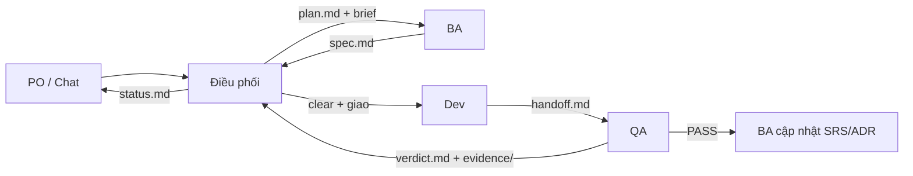

# Repository Guidelines

`dev-team` là **workspace điều phối** của team MausBot (department `tms`): chứa quy ước, template, định nghĩa bot và artifact các bot sinh ra. **Không chứa code dự án** — code nằm ở repo riêng, trỏ từ `projects/<proj>.json`.

Mọi bot/agent đọc file này trước, rồi `projects/<proj>.json` của project đang xử lý, và `FLOW.md` cho contract giao tiếp giữa các bot.

## 1. Project Overview

Mục đích: biến ticket thành thay đổi đã kiểm chứng qua một pipeline file-based gồm 4 vai, với bằng chứng tái tạo được. Actors: `ieu-phoi-tms` (Điều phối), `ba-tms`, `dev-tms`, `qa-tms`; PO là anh Văn Toàn — **người duy nhất clear task** trước khi Dev nhận.

Danh sách project là các file `projects/*.json` — không có bảng trùng trong tài liệu.

Khi thêm project mới, cần đủ 6 mục (không gửi token/secret):

- Tên project + folder slug (`<proj>`).
- Jira: base URL, project key, ticket prefix, người có quyền đọc — token để trong MCP/env của máy chạy, không vào repo.
- Repos: mỗi repo một object trong `repos[]` (`role`, `path`, `base`; thêm `remote` nếu có).
- Stack local: lệnh run/test/build từng repo, service phụ thuộc, env file.
- Evidence: nơi lưu file nặng (mặc định `evidence/` trong folder QA).
- Department: cần department MausBot riêng hay dùng agent hiện có.

Sau đó chạy:

```bash
./scripts/init-project.sh <proj> <registry.json>
```

Script validate schema, tạo `projects/<proj>.json` và cây `reports|docs|tests` (chỉ `.gitkeep`). Bỏ `<registry.json>` để tạo skeleton; `--force` để ghi đè. Schema tối thiểu: `project`, `jira`, `department`, `repos[]`, `stack` — dùng `null`/array rỗng cho giá trị chưa biết, không dùng placeholder.

Chỉ registry project dùng JSON; `spec.md`/`handoff.md`/`verdict.md` vẫn Markdown vì là prose + evidence.

Project nhiều repo: brief ghi scope allow/deny **theo từng repo**; `handoff.md`/`verdict.md` ghi một dòng mỗi repo (bảng repo trong template).

Ràng buộc:

- FMS chưa có department — tạo department riêng khi FMS vận hành; không gộp vào team TMS.
- Không checkout repo dự án vào `projects/` hay bất kỳ đâu trong `dev-team/`.
- Repo thật đang dùng cho TMS (theo evidence `ITMS-378`, đã ghi vào `projects/tms.json`): FE `/home/vif/tuan-vu/tms-web`, test harness `tests/tms`.
- Test code luôn nằm trong `tests/<proj>/` (path relative trong registry) — không trỏ ra ngoài workspace.
- Các repo khác dưới `/home/vif/tuan-vu/` (`FMS.*`, `tms_application`, …) chưa được đăng ký trong `projects/*.json` — chỉ dùng sau khi điền con trỏ.

## 2. Architecture & Data Flow

**Pattern: file-based blackboard, một chủ sở hữu cho mỗi artifact.** Bot sau đọc file của bot trước — không tin lời kể trong chat. Mỗi bước ghi đúng folder của bot sở hữu nó; artifact là nguồn sự thật duy nhất.



| Bước | Bot sở hữu | Artifact | Bot đọc tiếp | Nội dung bắt buộc |
|---|---|---|---|---|
| 1. Mở run | Điều phối | `reports/<proj>/orchestrator/<RUN-id>/plan.md` | BA | ticket key, mục tiêu, link context |
| 2. Chuẩn hóa | BA | `reports/<proj>/ba/<KEY>/spec.md` | Điều phối → PO duyệt | AC rõ, steps, rule nghiệp vụ, non-goals |
| 3. Giao Dev | Điều phối | brief trong `plan.md`/`status.md` | Dev | commit base, scope allow/deny, `done_when` |
| 4. Bàn giao | Dev | `reports/<proj>/dev/<KEY>/handoff.md` (+ `notes.md` nếu cần) | QA | branch/commit, cách chạy, API thay đổi, điểm QA chú ý |
| 5. Verify | QA | `reports/<proj>/qa/<KEY>/verdict.md` + `evidence/` | Điều phối, Dev | PASS/FAIL/BLOCKED **theo từng done-condition**, bằng chứng tự tái tạo |
| 6. Cập nhật docs | BA | `docs/<proj>/srs/*.md`, `docs/<proj>/adr/*.md` | team | rule thay đổi, hành vi mới, tham chiếu KEY |
| 7. Báo cáo | Điều phối | `reports/<proj>/orchestrator/<RUN-id>/status.md` | PO | trạng thái từng task, link verdict |

`KEY` = ticket key (`ITMS-378`) hoặc slug (`2026-11-20-doanh-thu`). `RUN-id` = `YYYY-MM-DD-<muc-tieu>`.

Ranh giới:

- Một task chỉ **xong** khi: code xong + test/build pass tại chỗ + QA `verdict.md` PASS. Xong task mới mở task tiếp theo.
- FAIL: Dev commit mới → cập nhật `handoff.md` (tăng "Lần bàn giao") → QA chạy lại trên **cùng folder KEY**.
- BLOCKED: ghi rõ điều kiện môi trường thiếu trong `verdict.md`; Điều phối quyết định retry hay trả PO.
- PASS: BA cập nhật SRS/ADR trước khi Điều phối báo PO.

Evidence:

- Nhẹ (`.md`, `.json`, `.txt`, `.png` nhỏ): commit trong `evidence/`.
- Nặng (`*.webm`, `*.mp4`, `*.xlsx`, `*.xls`, `*.zip`, `*.pdf`, `*/video/`, `videos/`): **git-ignored** — giữ trên filesystem, `verdict.md` ghi **đường dẫn tuyệt đối** hoặc link ngoài.
- Bằng chứng phải tự tái tạo được (ảnh/video/script + `*-result.json`), không chỉ mô tả bằng lời.

## 3. Key Directories

```text
dev-team/
├── AGENTS.md            # file này
├── FLOW.md              # contract giao tiếp giữa các bot
├── templates/           # mẫu điền-sẵn: qa-report, dev-handoff, ba-spec, orchestrator-run
├── team-config/         # MausBot department: team.md + skills/
├── scripts/             # init-project.sh: tạo registry + cây thư mục project
├── projects/            # <proj>.json: jira, department, repos, stack
├── reports/<proj>/<bot>/<KEY|RUN>/   # artifacts của từng lần chạy
├── docs/<proj>/srs|adr|research/     # tài liệu chính thức
├── tools/mausbot-orca/  # vendored watcher-first bridge → Orca (src+tests+dist)
└── tests/<proj>/        # test code (vd playwright)
```

| Path | Chứa | Không chứa |
|---|---|---|
| `reports/<proj>/<bot>/<KEY\|RUN>/` | artifact đúng bot sở hữu | file của bot khác |
| `docs/<proj>/srs\|adr\|research/` | tài liệu chính thức sau QA PASS | spec draft (nằm ở `reports/.../ba/`) |
| `tests/<proj>/` | test code của project | artifact điều phối |
| `team-config/` | `team.md` + `skills/` của department | code, docs dự án |
| `templates/` | mẫu gốc, copy-điền | file đã điền |
| `projects/` | con trỏ project (repo, env, prefix) | repo checkout |
| `tools/mausbot-orca/` | CLI `mausbot-orca` vendored (intec-kit@29a60c9), systemd watcher | task code, spec |

Trạng thái hiện tại (2026-11-20): chỉ `reports/tms/qa/ITMS-378/` có artifact; các folder khác là `.gitkeep`. SRS TMS đang nằm ở đường dẫn lặp `docs/tms/srs/srs/*.md` (đã commit) — sửa tại chỗ, không tạo bản thứ hai; đường dẫn chuẩn trong tài liệu là `docs/<proj>/srs/`.

`team-config/` là **source of truth** của department. Sửa souls/skills/flow ở đây thì bots đang chạy trong MausBot chỉ nhận bản mới sau khi **re-import** department. Mọi đường dẫn hardcode trong `team.md`/`skills/` phải trỏ `/home/vif/tuanvu/dev-team/` và layout theo project; tên skill trong `agents[].skills` phải khớp tên folder trong `skills/`.

Team chạy **native trên Orca** (4 bot: Orchestrator, ba-tms, dev-tms, qa-tms). `dev-tms`/`qa-tms` giao việc code/test cho Orca worker bằng `orca orchestration worker-start` qua skill `orca-dispatch` — repo Orca `name:tms-web` / `name:tms_application` (code) và `name:dev-team` (test + việc workspace). `tools/mausbot-orca/` là bridge legacy chỉ còn phục vụ bot trong MausBot; bot Orca **không gọi `mausbot-orca`**. Rebuild bridge (chỉ khi còn dùng MausBot): `cd tools/mausbot-orca && npm run build`; test: `npm test`.

## 4. Development Commands

Repo này không có build/lint/run — chỉ Markdown, JSON + git. Không thêm `package.json`/tooling root khi chỉ cần docs.

```bash
# Init project mới (registry + cây reports/docs/tests)
./scripts/init-project.sh <proj> <registry.json>

# Tìm artifact của một ticket
rg -n "ITMS-378" reports docs

# Tạo artifact từ template (copy, không sửa template gốc)
mkdir -p reports/tms/qa/ITMS-378 && cp templates/qa-report.md reports/tms/qa/ITMS-378/verdict.md

# Xác nhận evidence nặng đã bị ignore
git check-ignore -v reports/tms/qa/ITMS-378/evidence/qa-run/video/*.webm

# Validate registry project (đủ field tối thiểu, đúng kiểu)
for f in projects/*.json; do jq -e '(.project|type=="string") and (.repos|type=="array") and all(.repos[]; has("role") and has("path")) and (.stack|type=="object")' "$f" >/dev/null || exit 1; done
```

Lệnh run/test từng repo nằm trong `projects/<proj>.json` → `stack` (TMS: `projects/tms.json`). Riêng harness: `cd tests/tms && pnpm install` (một lần); `node_modules` đã git-ignore.

QA ad-hoc dùng script CommonJS trong folder QA, import Playwright bằng đường dẫn tuyệt đối vào `node_modules` của `tests/tms`:

```bash
node reports/tms/qa/ITMS-378/qa-verify-itms-378.cjs <outDir> <username> <password> <label>
```

## 5. Code Conventions & Common Patterns

Repo không có runtime code: async patterns, dependency injection, state management **không áp dụng**. Thay vào đó là state machine của workflow.

- **Naming:** folder/file `kebab-case`, không dấu, không khoảng trắng. Ticket key giữ nguyên prefix hoa (`ITMS-378`), folder project chữ thường (`tms/`). Report key phải khớp ticket key — `ITMS-378` → `reports/tms/qa/ITMS-378/`, **không** `reports/itms/...`.
- **Ngôn ngữ:** prose tiếng Việt trong report/docs; giữ nguyên ID, path, ticket key, thuật ngữ kỹ thuật.
- **Artifact:** mọi file điền từ `templates/*.md`; giữ đúng heading/field của template, điền `<placeholder>` thay vì xoá field. Template gốc chỉ đọc.
- **Trạng thái:** dùng đúng nhãn của `templates/orchestrator-run.md`: ⏳ chờ clear → 📋 BA spec → 💻 Dev → 🔍 QA → ✅ PASS / ❌ FAIL / 🚫 BLOCKED.
- **JSON:** 2 spaces, key `snake_case`, `null`/`[]` cho giá trị chưa biết; không placeholder.
- **Commit:** Conventional Commits, tiếng Anh, imperative, không scope (theo mẫu hiện có: `chore: bootstrap team conventions v1`).
- **Đổi convention:** sửa `AGENTS.md`/`FLOW.md` + template liên quan **trong cùng một commit**.
- **Không thêm** folder/bot/template "phòng khi" — chỉ thêm khi bot đó tồn tại thật.

## 6. Important Files

| File | Vai trò |
|---|---|
| `AGENTS.md` | Quy ước workspace (file này) — đọc trước mọi việc |
| `FLOW.md` | Contract bàn giao giữa các bot; nguồn của §2 |
| `templates/qa-report.md` | Mẫu `verdict.md` — PASS/FAIL/BLOCKED, done-conditions, đối chiếu |
| `templates/dev-handoff.md` | Mẫu `handoff.md` — branch/commit, API diff, cách verify |
| `templates/ba-spec.md` | Mẫu `spec.md` — AC, scope, rule nghiệp vụ |
| `templates/orchestrator-run.md` | Mẫu `plan.md` + `status.md` — task briefs, trạng thái |
| `team-config/team.md` | Department `tms`: room, 4 bot, soul, skills |
| `team-config/skills/*/SKILL.md` | 6 skill: `tms-delivery-coordination`, `ba-ticket-to-srs-br`, `ba-srs-docx-env-check`, `qa-verify-export-local`, `tms-excel-export-verify`, `orca-dispatch` |
| `projects/{tms,fms,ca-nhan}.json` | Registry project: Jira, department, repos, stack; `null` = chưa biết |
| `scripts/init-project.sh` | Tạo registry + cây `reports/docs/tests` cho project mới |
| `scripts/stack.sh` | Quản lý stack local duy nhất (`up`/`down`/`status`/`reset-db`) với lock ở `~/.local/state/tms-stack/lock.json` |
| `tests/tms/seed/001-tenant-and-users.sql` | Seed cố định tenant `tuanvudev` + tài khoản QA (lấy credential từ `tests/tms/.env`) |
| `.gitignore` | Chặn evidence nặng, `node_modules/`, `__pycache__/`, `*.log` |
| `reports/tms/qa/ITMS-378/ITMS-378-qa-report.md` | Ví dụ QA đã chạy: PASS AC-01→07, AC-08 known limitation |

## 7. Runtime/Tooling Preferences

- Workspace: không cần runtime/package manager; git + Markdown/JSON là đủ.
- TMS FE: Node + pnpm/`npx`; Next.js server port `4700` (luôn khởi động qua `scripts/stack.sh`, không chạy `next`/`go`/`nohup` trực tiếp).
- Test harness `tests/tms`: Node 22 + pnpm, Playwright Chromium. Python poller/dashboard không thuộc test path — còn ở `/home/vif/tuan-vu/tms-test` nếu cần.
- QA probe: plain Node CommonJS, mượn `@playwright/test` từ `tests/tms/node_modules`; không tạo dependency riêng trong `reports/`.
- Secrets: `.env` (trong `tests/tms` hoặc `/home/vif/tuan-vu/tms-test`) chứa credential — đã git-ignore, không commit/copy giá trị; dùng `.env.example`.
- Browser automation: `--host-resolver-rules=MAP tuanvudev.localhost 127.0.0.1` cho tenant local.

## 8. Testing & QA

- **Gate:** QA TMS kiểm chứng độc lập, không dựa vào lời Dev. Kết quả ghi `verdict.md` với PASS/FAIL/BLOCKED cho **từng** done-condition; thiếu bằng chứng = FAIL, không phải PASS.
- **Harness:** `tests/tms/` (Playwright), tự discover project từ `tests/<company>/<app>/` có `e2e/` (hiện `tuanvu/tms`). Lệnh chạy: `projects/tms.json` → `stack`.
- **Phạm vi mỗi ticket:** map đủ AC → evidence; kiểm cả ca âm và ca dương (không quyền / có quyền), regression 401/403 và endpoint liền kề; với export, đối chiếu output ↔ mẫu ticket ↔ DB, kiểm merge cell.
- **Evidence:** theo policy ở §2 — file nhẹ commit, file nặng để ngoài git và ghi đường dẫn tuyệt đối trong `verdict.md`.
- **Đặt tên:** `qa-verify-<key>.cjs` cho luồng đầy đủ, `qa-probe-<topic>.cjs` cho probe, output `*-result.json` + ảnh/video trong `evidence/`.
- **Không có coverage số** cho repo docs; tiêu chuẩn là 100% done-condition có evidence tái tạo được. Gap hiện tại: `tests/tms/.env` chưa tạo (copy từ `.env.example`) và `projects/tms.json` thiếu `jira.base_url`/`project_key`.
