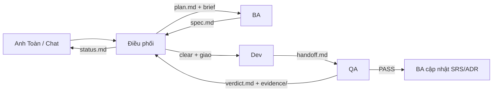

# FLOW — contract giao tiếp giữa các bot

Nguyên tắc: **bot sau đọc file của bot trước, không tin lời kể trong chat.** Mỗi mũi bàn giao là một file trong `reports/<proj>/`, ghi đúng folder của bot sở hữu nó (xem `AGENTS.md` mục 2).

## Luồng một task

## Contract từng bước

| Bước | File | Bot đọc tiếp | Nội dung bắt buộc |
|---|---|---|---|
| 1. Điều phối mở run | `reports/<proj>/orchestrator/<RUN>/plan.md` | BA | ticket key, mục tiêu, link context |
| 2. BA chuẩn hóa | `reports/<proj>/ba/<KEY>/spec.md` | Điều phối → PO duyệt | AC rõ, steps, rule nghiệp vụ, non-goals |
| 3. Điều phối giao Dev | brief trong `plan.md`/`status.md` | Dev | commit base, scope allow/deny, done_when |
| 4. Dev bàn giao | `reports/<proj>/dev/<KEY>/handoff.md` | QA | branch/commit, cách chạy, API thay đổi, điểm cần QA chú ý |
| 5. QA verify | `reports/<proj>/qa/<KEY>/verdict.md` + `evidence/` | Điều phối, Dev | PASS/FAIL/BLOCKED theo từng done-condition, bằng chứng tự tái tạo (ảnh/video/script — file nặng ghi đường dẫn) |
| 6. QA PASS → BA cập nhật | `docs/<proj>/srs/*.md`, `docs/<proj>/adr/*.md` | team | rule thay đổi, hành vi mới, tham chiếu KEY |
| 7. Điều phối báo cáo | `reports/<proj>/orchestrator/<RUN>/status.md` | anh Toàn | trạng thái từng task, link verdict |

## Ranh giới

- Một task chỉ **xong** khi: code xong + test/build pass tại chỗ + QA `verdict.md` PASS. Mới qua task tiếp theo.
- QA trả BLOCKED: ghi rõ điều kiện môi trường thiếu trong `verdict.md`; Điều phối quyết định retry hay trả PO.
- Dev sửa sau FAIL: commit mới → update `handoff.md` (ghi lần retry) → QA chạy lại trên cùng folder KEY.
- Mọi task phải được anh Toàn clear trước khi Dev nhận — Điều phối không thay PO phê duyệt.

## Evidence

- Kết quả nhẹ (`.md`, `.json`, `.txt`, `.png` nhỏ): commit trong `evidence/`.
- Nhị phân nặng (`.webm`, `.mp4`, `.xlsx`, `.pdf`, thư mục `video/`): git-ignored — lưu tại `evidence/` trên đĩa, `verdict.md` ghi **đường dẫn tuyệt đối** hoặc link ngoài.
