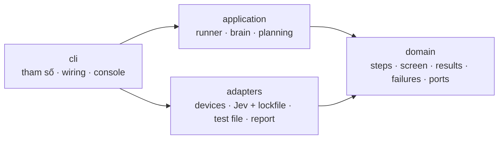
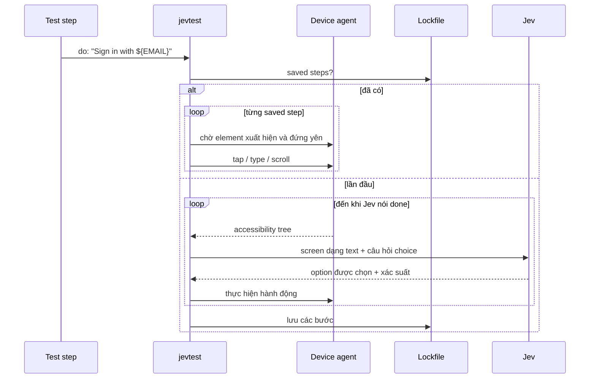

# Nghiên cứu: jevtest — kiến trúc và khả năng tích hợp vào test web

**Ngày thực hiện:** 2026-11-23
**Đối tượng:** [`Just-Betr/jevtest`](https://github.com/Just-Betr/jevtest) v0.10.0 (MIT), commit `bfd9c1c`
**Bối cảnh:** TMS dùng Next.js + Playwright (`tests/tms`); câu hỏi là có thể dùng jevtest cho test web và tối ưu tốc độ test hay không.

## Kết luận trước (TL;DR)

jevtest hiện **không có platform web**. Nó là runner E2E cho Android và iOS; `app:` và `device:` chỉ nhận `android`/`ios`, và web chỉ xuất hiện dưới dạng **WebView trong app mobile**. Muốn test web thật phải viết thêm một `WebDevice` adapter và mở rộng domain — kiến trúc ports/adapters cho phép việc đó, nhưng đây là một fork/PR cỡ 3–5 ngày cho MVP và 1–2 tuần để đạt chuẩn chất lượng của upstream, không phải một dòng cấu hình.

Về tốc độ, jevtest có một ý tưởng rất đúng: **mọi quyết định của model được ghi vào lockfile, lần chạy sau replay không gọi mạng**. Nhưng mỗi bước replay vẫn có sàn chờ bằng một `interval` (mặc định 250 ms) cộng hai lần đọc screen. Đo trên Chromium headless với trang 300 phần tử: một bước replay mất **316 ms** ở interval 0,25 s, **104 ms** ở 0,05 s và **50 ms** nếu bỏ chờ; Playwright trực tiếp mất **16–34 ms** mỗi thao tác. Với TMS, khuyến nghị là **giữ Playwright cho web**, không port jevtest; chỉ dùng jevtest khi có app mobile/WebView thật.

## Mục lục

1. [Phạm vi và phương pháp](#1-phạm-vi-và-phương-pháp)
2. [Tổng quan dự án](#2-tổng-quan-dự-án)
3. [Kiến trúc](#3-kiến-trúc)
4. [Cơ chế chạy và tính tất định](#4-cơ-chế-chạy-và-tính-tất-định)
5. [Khả năng test web hiện tại](#5-khả-năng-test-web-hiện-tại)
6. [Thiết kế tích hợp web khả thi](#6-thiết-kế-tích-hợp-web-khả-thi)
7. [Tốc độ test](#7-tốc-độ-test)
8. [Khuyến nghị](#8-khuyến-nghị)
9. [Câu hỏi chưa giải quyết](#9-câu-hỏi-chưa-giải-quyết)
10. [Nguồn](#10-nguồn)

## 1. Phạm vi và phương pháp

Câu hỏi nghiên cứu gồm hai phần: (a) jevtest có thể tích hợp vào quy trình test web không, và (b) nó giúp tối ưu tốc độ test đến đâu. Tiêu chí đánh giá là mức thay đổi code cần thiết, độ chắc chắn của kết quả replay, tốc độ mỗi bước, và chi phí vận hành thêm (toolchain, model API).

Tôi đọc toàn bộ source Python (9.790 dòng), toàn bộ `docs/`, `CHANGELOG.md`, cấu hình CI, và các issue hiện có. Số liệu tốc độ mobile lấy từ tài liệu đo của dự án; số liệu web do tôi tự đo bằng Playwright 1.65 + Chromium headless trên máy local, trang tổng hợp 300 phần tử, lấy trung vị của 25–50 lần chạy. Các nguồn ngoài gồm tài liệu Playwright về auto-waiting/ARIA snapshot, tài liệu TypeSafe về Jev, GitHub API và PyPI.

Giới hạn: tôi không chạy jevtest trên thiết bị Android/iOS thật, nên các con số mobile là số của tác giả dự án, không phải số tôi tái lập. Benchmark web dùng trang tổng hợp, không phải app TMS thật; nó đo chi phí cơ chế, không đo độ phức tạp DOM của TMS.

## 2. Tổng quan dự án

jevtest cho phép viết test bằng YAML gần ngôn ngữ tự nhiên. Một bước `do:` mô tả mục tiêu; model Jev của TypeSafe chọn hành động kế tiếp từ đúng các option có trên màn hình, và các bước đã chọn được lưu vào lockfile để lần sau replay y hệt. Các bước chính xác như `tap:`, `type:`, `see:` không cần model.

Dự án ở trạng thái beta sớm: phiên bản 0.10.0, 4 sao, 2 fork, 1 issue mở (#8) cùng 2 PR dependabot, một tác giả duy nhất, commit gần nhất 2026-11-15. Issue mở đáng chú ý là [#8](https://github.com/Just-Betr/jevtest/issues/8) — cho phép chọn provider Jev (TypeSafe hoặc OpenRouter); không có issue nào về web. Điều này xác nhận web không nằm trong roadmap hiện tại.

Chất lượng kỹ thuật cao hơn mức một dự án 4 sao thường có: import-linter chặn dependency chạy ngược, mypy strict và pyright strict không có `Any`, toàn bộ rule ruff, coverage 100% line và branch, test Hypothesis cho mọi input đọc từ ngoài. Đây là lý do đáng để đọc kiến trúc của nó dù không dùng trực tiếp.

## 3. Kiến trúc

jevtest theo clean architecture: dependency chỉ trỏ vào trong, và luật này bị CI chặn bằng `import-linter`.

`domain` chứa kiểu dữ liệu thuần và các **port** (`Device`, `DecisionModel`, `Clock`, `RunListener`, `ScreenNotesWriter`). `application` chứa runner, brain (dựng câu hỏi cho model) và sharding; nó chỉ nói chuyện qua port. `adapters` chứa Android/iOS, client Jev, lockfile, loader YAML, report. `cli` là composition root duy nhất chọn implementation thật.

Điểm mấu chốt cho khả năng mở rộng: `Device` là một Protocol 32 method, không phải base class gắn với mobile ([`ports.py:22`](https://github.com/Just-Betr/jevtest/blob/main/jevtest/domain/ports.py#L22)). Application layer không biết adb, XCUITest hay Playwright tồn tại. Vì vậy về nguyên tắc, một browser adapter lắp vào được mà không sửa runner.

Tuy vậy, domain vẫn còn giả định mobile ở vài chỗ:

| Vị trí | Giả định | Ảnh hưởng khi thêm web |
|---|---|---|
| `domain/kinds.py` | `Platform` chỉ có `ANDROID`, `IOS` ([`kinds.py:8`](https://github.com/Just-Betr/jevtest/blob/main/jevtest/domain/kinds.py#L8)) | Phải thêm `WEB`; lockfile, report, CLI đều đọc enum này |
| `domain/steps.py` | `Suite.apps: Mapping[Platform, Path]` ([`steps.py:383`](https://github.com/Just-Betr/jevtest/blob/main/jevtest/domain/steps.py#L383)) | URL không phải `Path`; phải đổi kiểu hoặc thêm `WebApp` |
| `adapters/testfile/loader.py` | Chỉ nhận `.apk/.aab/.app/.zip/.ipa` ([`loader.py:30`](https://github.com/Just-Betr/jevtest/blob/main/jevtest/adapters/testfile/loader.py#L30)); báo lỗi “keys must be android and/or ios” ([`loader.py:296`](https://github.com/Just-Betr/jevtest/blob/main/jevtest/adapters/testfile/loader.py#L296)) | Phải thêm nhánh `web:` và validate step mobile-only |
| `domain/screen.py` | `Screen` có `system_bars`, `keyboard_*`, `bars`, `offscreen` | Web đặt các trường này rỗng/false; `offscreen` vẫn hữu ích cho lazy list |
| `domain/steps.py` | Có `Rotate`, `Network`, `AutofillOff`, `Grant`, `Location`, `Home`, `Reinstall` | Phải định nghĩa hành vi web hoặc từ chối ngay khi load file |

Ngoài ra, `Device.looks()` tồn tại để phát hiện animation bằng pixel trên Android ([`android.py:530`](https://github.com/Just-Betr/jevtest/blob/main/jevtest/adapters/devices/android.py#L530)). Web không cần pixel: có thể trả chuỗi rỗng hoặc hash rect/opacity, rẻ hơn nhiều.

## 4. Cơ chế chạy và tính tất định

Hai cơ chế làm nên tính tất định:

1. **Saved steps** cho mỗi `do:`, lưu theo platform. Replay không gọi mạng, chỉ cần element còn xuất hiện.
2. **Recorded answers** cho `expect:` và trường hợp nhiều element trùng tên, key là hash của `(model, state, questions)` ([`lockfile.py:53`](https://github.com/Just-Betr/jevtest/blob/main/jevtest/adapters/jev/lockfile.py#L53)). Cùng một screen và câu hỏi luôn ra cùng đáp án.

Hệ quả quan trọng: **jevtest không dùng LLM để sinh text**. Jev chỉ chọn trong danh sách option; mọi text gõ vào đều lấy từ file test. Đây là lý do nó an toàn hơn các “AI browser agent” kiểu prompt-to-action, và cũng là lý do replay nhanh: không có suy luận tại runtime.

Mặt trái: bất kỳ thay đổi nào ở screen cũng làm hash đổi, nên `expect:` trên web động (đồng hồ, quảng cáo, A/B test, dữ liệu realtime) sẽ miss lockfile và gọi Jev. Tài liệu client ghi nhận trung vị 0,2 s nhưng p75 từ 8–29 s ([`client.py:30`](https://github.com/Just-Betr/jevtest/blob/main/jevtest/adapters/jev/client.py#L30)). Với web, đây là rủi ro tốc độ lớn hơn cả việc đọc DOM.

## 5. Khả năng test web hiện tại

Không có. Bằng chứng trực tiếp:

- `Platform` chỉ có `android`, `ios`; `--platform` chỉ nhận hai giá trị này.
- Loader từ chối `app: {web: ...}` và `device: {web: ...}`; test của chính dự án khẳng định lỗi này ([`test_loader.py:158`](https://github.com/Just-Betr/jevtest/blob/main/tests/adapters/testfile/test_loader.py#L158)).
- `make_device` chỉ rẽ nhánh Android/iOS ([`main.py:43`](https://github.com/Just-Betr/jevtest/blob/main/jevtest/cli/main.py#L43)); finder cũng vậy.
- Topic của repo là `mobile`, `android`, `ios`, `webview`; README mô tả “end-to-end tests for Android and iOS apps”.

Thứ duy nhất chạm tới web là **WebView trong app**. Tài liệu `guides/webviews.md` ghi nhận nó hoạt động với HTML thường: input, select, radio, checkbox, form, alert, scroll. Nhưng có một cảnh báo quan trọng: tên để tìm một field web **phụ thuộc phiên bản WebView**. Cùng một `<label for="name">` + `<input id="name">`, kết quả đo của dự án:

| Nền tảng | `into: Your name` (label) | `into: name` (id) |
|---|---|---|
| Android 12, WebView 91 | ✗ | ✓ |
| Android 15, WebView 124 | ✓ | ✗ |
| Android 13, WebView 146 | ✓ | ✓ |
| Android 17, WebView 153 | ✗ | ✓ |
| iOS 26, 27 | ✓ | ✗ |

Vì vậy “test web bằng cách bọc web app vào WebView” không phải là test web thật: nó test WebView của một OS cụ thể, chậm hơn browser thật, và tên element có thể đổi sau một lần update WebView. Phương án này bị loại.

## 6. Thiết kế tích hợp web khả thi

Nếu vẫn muốn tích hợp, cách sạch nhất là thêm một adapter `WebDevice` dùng Playwright (Python) hoặc CDP trực tiếp, cộng một bộ chuyển DOM → `Screen`. Không cần sửa runner, brain hay lockfile logic.

### 6.1. Thay đổi theo file

| File | Thay đổi | Ước lượng |
|---|---|---|
| `domain/kinds.py` | Thêm `Platform.WEB = "web"` | 1 dòng |
| `domain/steps.py` | `apps: Mapping[Platform, Path]` → kiểu union `Path \| WebApp(url)`; `Job.app` | ~20 dòng + call site |
| `adapters/testfile/loader.py` | Nhận `app: {web: https://...}`, `device: {web: chromium}`; từ chối step mobile-only trên web | ~60 dòng |
| `adapters/devices/web.py` | `WebDevice` implement 32 method của `Device` | 450–600 dòng |
| `adapters/devices/web_screen.py` | JS snapshot DOM → `Screen`/`Element` | 150–250 dòng |
| `adapters/devices/finder.py` | Tìm/claim browser, kiểm tra binary | ~30 dòng |
| `cli/main.py`, `cli/run.py` | Wiring, bỏ check build cho web, report URL | ~30 dòng |
| `tests/` | Unit test cho snapshot, fake page, integration với local server | 300–500 dòng |

Ước lượng MVP: 3–5 ngày cho một người đã quen codebase. Để merge upstream (coverage 100%, mypy/pyright strict, import-linter, Hypothesis): 1–2 tuần, chưa kể vòng review với tác giả.

### 6.2. Mapping `Device` → Playwright/CDP

Trong 32 method, khoảng 25 map gần như 1:1, 2 là no-op, 5 cần quyết định thiết kế:

| Nhóm | Method | Cách làm trên web |
|---|---|---|
| Lifecycle | `install`, `launch`, `resume`, `stop`, `reload`, `clear_data`, `reinstall` | `page.goto(url)`, `reload`, `close`; `fresh: true` tạo browser context mới; `storageState` để tái dùng đăng nhập |
| Screen | `screen`, `screenshot`, `looks`, `app_state` | Snapshot DOM + `getBoundingClientRect`; `page.screenshot`; `looks` trả `""` hoặc hash style; `app_state` từ `page.isClosed()` và `document.visibilityState` |
| Gesture | `tap`, `double_tap`, `long_press`, `swipe`, `scroll` | `Input.dispatchMouseEvent`/`Touch` tại toạ độ; wheel cho scroll; `scrollIntoView` cho `scroll_to` |
| Text | `type_text`, `clear_text`, `key`, `choose` | `keyboard.insertText`, select-all + delete, `keyboard.press`, `selectOption` |
| Navigation | `back`, `open_url`, `home` | `history.back()`, `page.goto`, `home` nên từ chối hoặc về URL gốc |
| Device state | `rotate`, `dark_mode`, `grant`, `network`, `set_location` | Đổi viewport, `emulateMedia`, `grantPermissions`, `setOffline`, `setGeolocation` |
| No-op | `hide_keyboard`, `autofill_off` | Không có bàn phím ảo/autofill service trên browser |
| Cần thiết kế | `prepare_for_test`, `restore`, `close`, `app_state` | Quản lý context, storage, dialog, tab; định nghĩa “app đã rời foreground” cho web |

### 6.3. Chuyển DOM thành `Screen`

Đây là phần khó nhất và quyết định chất lượng. `Element` cần `kind`, `text`, `parts`, `hint`, `resource_id`, `bounds`, `editable`, `clickable`, `scrollable`, `checked`, `value`, `position`. Web có thể lấy:

- `kind` từ tag + `role` (button, link, textbox, checkbox, radio, combobox, heading…).
- `text` từ accessible name: `aria-label`, `aria-labelledby`, `<label for>`, `alt`, `title`, `textContent`.
- `hint` từ `placeholder`.
- `resource_id` từ `id` hoặc `data-testid`.
- `bounds` từ `getBoundingClientRect()` + scroll offset.
- `editable` từ `input/textarea/[contenteditable]`; `scrollable` từ `scrollHeight > clientHeight`.
- `offscreen` từ các element có rect ngoài viewport hoặc bị `overflow: hidden` cắt.

Các giới hạn cần chấp nhận: cross-origin iframe phải evaluate theo từng frame; shadow DOM phải walk `shadowRoot`; virtual list chỉ có phần tử đang render trong DOM (mobile agent thì báo được text offscreen); canvas/SVG không có accessible name thì vẫn vô hình — đúng như giới hạn của jevtest trên mobile. Native browser dialog (`alert`, `confirm`) không phải element trong DOM; phải map sang `Screen` hoặc auto-handle, khác với mô hình “dialog là một phần của screen” của mobile.

### 6.4. Các phương án tích hợp

| Phương án | Việc phải làm | Chi phí | Rủi ro | Khi nào chọn |
|---|---|---|---|---|
| **A. Fork + `WebDevice`** | Như bảng 6.1 | 3–5 ngày MVP, 1–2 tuần đạt chuẩn | Drift với upstream; thêm Python vào CI Node; mất hệ sinh thái Playwright | Khi cần DSL plain-English + lockfile cho web và chấp nhận bảo trì fork |
| **B. Giữ Playwright cho web, jevtest cho mobile/WebView** | Không code | 0 | Không có plain-English cho web | **Khuyến nghị ngay** |
| **C. Lớp mỏng trên Playwright** | YAML step → locator; `do:` → Jev record → saved steps → codegen spec | 3–5 ngày | Chỉ đáng nếu authoring là pain thật; vẫn phải nuôi Jev | Khi muốn thử ý tưởng mà không fork |
| **D. Bọc web app trong WebView** | Không | Thấp | Không phải test web thật; chậm; tên field đổi theo WebView | Loại |

Phương án B là mặc định đúng cho TMS: web đã có Playwright, chạy nhanh hơn, có tracing/network mock/sharding/multi-browser, và không thêm toolchain Python. jevtest chỉ có nghĩa nếu TMS có app mobile hoặc WebView cần test — hiện registry TMS chỉ có web.

### 6.5. Touchpoint chính xác của một `web` platform

`plan()` không cần thêm “trục job thứ tư”: nó đã tạo một `Job` cho mỗi cặp `(platform, device)` ([`run.py:128`](https://github.com/Just-Betr/jevtest/blob/main/jevtest/cli/run.py#L128)), và `shard()` chỉ chia test theo số device, không biết platform ([`planning.py:10`](https://github.com/Just-Betr/jevtest/blob/main/jevtest/application/planning.py#L10)). Thêm `web` là thêm **giá trị thứ ba** vào trục sẵn có, không phải thêm cơ chế song song. Các điểm chạm thực sự:

| Touchpoint | Hiện tại | Cần đổi cho web |
|---|---|---|
| `Platform` enum | `ANDROID`, `IOS` ([`kinds.py:8`](https://github.com/Just-Betr/jevtest/blob/main/jevtest/domain/kinds.py#L8)) | Thêm `WEB`; mọi nơi đọc enum tự nhận giá trị mới |
| `Suite.apps` | `Mapping[Platform, Path]` ([`steps.py:383`](https://github.com/Just-Betr/jevtest/blob/main/jevtest/domain/steps.py#L383)) | `Path \| WebApp(url)`; `Job.app` ([`run.py:96`](https://github.com/Just-Betr/jevtest/blob/main/jevtest/cli/run.py#L96)) và `_check_builds` ([`run.py:299`](https://github.com/Just-Betr/jevtest/blob/main/jevtest/cli/run.py#L299)) phải bỏ qua `.exists()` cho web |
| Loader | Chỉ nhận extension mobile ([`loader.py:30`](https://github.com/Just-Betr/jevtest/blob/main/jevtest/adapters/testfile/loader.py#L30)); từ chối key lạ ([`loader.py:296`](https://github.com/Just-Betr/jevtest/blob/main/jevtest/adapters/testfile/loader.py#L296), [`loader.py:316`](https://github.com/Just-Betr/jevtest/blob/main/jevtest/adapters/testfile/loader.py#L316)) | Nhận `app: {web: https://...}` và `device: {web: chromium}`; validate step mobile-only |
| `--platform` | choices lấy từ enum ([`main.py:71`](https://github.com/Just-Betr/jevtest/blob/main/jevtest/cli/main.py#L71)) | Tự có `web` khi thêm enum; sửa thông báo lỗi “no android/ios build” |
| Finder/claim | Rẽ nhánh Android/iOS ([`finder.py:21`](https://github.com/Just-Betr/jevtest/blob/main/jevtest/adapters/devices/finder.py#L21)), claim theo serial/UDID | Claim theo tên browser/profile; kiểm tra binary Playwright/Chromium |
| `plan()` output | `out/<platform>/<device>` ([`run.py:128`](https://github.com/Just-Betr/jevtest/blob/main/jevtest/cli/run.py#L128)) | Giữ nguyên; `platform.value = "web"` |
| Lockfile saved steps | Key `f"{platform} · {where} · {goal}"` ([`runner.py:714`](https://github.com/Just-Betr/jevtest/blob/main/jevtest/application/runner.py#L714)) | Tự tách theo platform; web có saved steps riêng, không lẫn mobile |
| Lockfile recorded answers | Hash `(model, state, questions)` ([`lockfile.py:53`](https://github.com/Just-Betr/jevtest/blob/main/jevtest/adapters/jev/lockfile.py#L53)) | Không có platform trong key; nhưng `state` là text của screen, nên web gần như chắc chắn khác mobile. Nếu trùng tuyệt đối thì dùng chung đáp án là vô hại |
| `Undo` | File theo device id; entry rotation/dark/network/autofill/location ([`android.py:553`](https://github.com/Just-Betr/jevtest/blob/main/jevtest/adapters/devices/android.py#L553), [`ios.py:609`](https://github.com/Just-Betr/jevtest/blob/main/jevtest/adapters/devices/ios.py#L609)) | Web: state nằm trong browser context, không cần file undo trên đĩa; no-op hoặc map sang context, nhưng phải dùng device id của browser |
| `app_state`/`Screen` | `keyboard_*`, `system_bars`, `bars` là khái niệm mobile ([`screen.py`](https://github.com/Just-Betr/jevtest/blob/main/jevtest/domain/screen.py)) | Web đặt rỗng/false; `app_state` từ `page.isClosed()`/`visibilityState` |

Kết luận của phần này: **sharding và lockfile không phải rào cản**; rào cản thật là kiểu `app` (Path → URL), bộ chuyển DOM → `Screen`, và ngữ nghĩa các step mobile-only. Điều này khớp với ước lượng 3–5 ngày MVP ở trên.

## 7. Tốc độ test

### 7.1. Số đo

Benchmark của tôi trên Chromium headless, trang tổng hợp 300 phần tử (trung vị):

| Thao tác | Thời gian |
|---|---|
| Đọc DOM → snapshot một lần | 19,1 ms |
| Playwright `click` | 34,0 ms |
| Playwright `fill` | 16,0 ms |
| Một bước replay, interval = 0 | 50,5 ms |
| Một bước replay, interval = 0,05 s | 104,1 ms |
| Một bước replay, interval = 0,25 s (mặc định) | 316,3 ms |

“Một bước replay” mô phỏng đúng đường đi của jevtest: đọc screen, chờ `interval`, đọc lại để xác nhận element đứng yên, rồi click. Số đo mobile của dự án để so sánh: đọc screen mất 7 ms trên Android emulator, 55 ms trên Pixel 4a, 39 ms trên iOS simulator, 170 ms trên iPhone qua USB. Demo suite 17 test mất 104 s trên Android và 212 s trên iOS khi chạy tuần tự; chạy 3 thiết bị song song mất 218 s cho 34 lượt test.

### 7.2. Thời gian đi đâu

Mỗi bước tìm element (`tap:`, `type:`, saved step) chạy `_find` → `_wait_until`: đọc screen, nếu element chưa “đứng yên” thì ngủ `interval` rồi đọc lại ([`runner.py:285`](https://github.com/Just-Betr/jevtest/blob/main/jevtest/application/runner.py#L285), [`runner.py:387`](https://github.com/Just-Betr/jevtest/blob/main/jevtest/application/runner.py#L387)). `Stillness` cần hai lần đọc giống nhau, nên **luôn có ít nhất một lần ngủ interval cho mỗi bước tìm element**. Trên mobile, Android còn gọi thêm `looks()` để chụp pixel; iOS trả rỗng. Trên web, `looks()` có thể trả rỗng, nhưng sàn interval vẫn còn.

Với interval mặc định 0,25 s, một suite 100 bước có ít nhất ~25 s chỉ để chờ, chưa tính thao tác và thời gian app phản hồi. Đây là điểm khác biệt lớn nhất so với Playwright: Playwright kiểm tra actionability bên trong engine, stable = hai animation frame (~16 ms), nên `click` chỉ mất ~34 ms.

`see:`/`not_see:` chỉ đọc một lần nếu điều kiện đúng ngay, nên rẻ hơn `tap:` và rẻ hơn `expect:` (phải hai lần đọc + tra lockfile/Jev). `expect:` trên web động là điểm chậm nhất vì hash screen đổi liên tục.

### 7.3. Song song

jevtest shard test trong một file cho nhiều thiết bị, mỗi thiết bị một thread ([`planning.py:10`](https://github.com/Just-Betr/jevtest/blob/main/jevtest/application/planning.py#L10), [`run.py:237`](https://github.com/Just-Betr/jevtest/blob/main/jevtest/cli/run.py#L237)). Các file chạy tuần tự. Với web, “thiết bị” có thể là nhiều browser context; nhưng `fresh: false` bị ghim vào context của test trước, nên muốn song song tốt phải chia file hoặc chấp nhận ít shard. Playwright có `workers`, `--shard`, `fullyParallel` trưởng thành hơn nhiều.

### 7.4. Cách tối ưu nếu vẫn port

1. Đặt `interval: 0.05` (mức thấp nhất được phép) trong file test web; đây là đòn bẩy lớn nhất, giảm sàn chờ từ 250 ms xuống 50 ms mỗi bước.
2. Cho `WebDevice.looks()` trả rỗng và cache snapshot vừa đọc để `screen()` + `looks()` không đọc DOM hai lần.
3. Dùng `see:` thay `expect:` ở mọi chỗ có thể; `expect:` chỉ để kiểm tra ngữ nghĩa mà text không diễn đạt được.
4. CI chạy `--lock frozen` để không gọi mạng và không cần API key; record ở local rồi commit lockfile.
5. Dùng nhiều browser context làm nhiều “device”, chia test theo file để tận dụng thread.
6. Dùng `fresh: false` cho luồng liên tiếp để tái dùng context; `fresh: true` tạo context mới rẻ hơn reinstall app rất nhiều.
7. Hạ `timeout` cho test web (3–5 s thay vì 10 s) để fail nhanh khi element biến mất.

### 7.5. Tối ưu Playwright cho TMS (không liên quan jevtest)

Nếu mục tiêu thực sự là tốc độ, các đòn bẩy quen thuộc nhưng hiệu quả hơn nhiều so với việc port jevtest: chạy `workers` theo số core, `fullyParallel`, `--shard` trong CI; tái dùng `storageState` thay vì login qua UI mỗi test; `reducedMotion: 'reduce'`; trace chỉ khi retry; không dùng `waitForTimeout`; web-first assertion; build một lần và chạy trên stack local đã `reset-db`; tách suite theo module để shard đều. Những việc này giữ nguyên hệ sinh thái và không thêm 250 ms/bước.

### 7.6. Mẫu kiến trúc đáng tham khảo (không cần port)

Câu trả lời ngắn: **có, tham khảo được — nhưng tham khảo nguyên lý, không bê runtime**. Các mẫu dưới đây chuyển được sang Playwright/TypeScript mà không thêm Python hay Jev; cột “kỳ vọng” là suy luận từ cơ chế, chưa đo trên suite TMS thật.

| Mẫu trong jevtest | Vì sao nhanh/ổn định | Tương đương Playwright | Kỳ vọng |
|---|---|---|---|
| Driver/agent thường trú cho cả run ([`android.py`](https://github.com/Just-Betr/jevtest/blob/main/jevtest/adapters/devices/android.py)) | Không spawn process/khởi động lại thiết bị mỗi thao tác; đọc screen 7 ms trên emulator | Một browser process cho cả worker; context mới mỗi test; không `launch()` trong từng test | Cao: bỏ 300–800 ms launch/test |
| Đọc screen một lần, tái dùng cho nhiều check (`_wait_until` đọc rồi kiểm) | Tránh N round-trip DOM cho N assertion | Một `page.evaluate` snapshot cho một cụm check; `expect.poll` trên dữ liệu đã lấy | Trung bình: ~1 ms/round-trip (đo 0,6–0,8 ms), nhân với số check |
| Wait-theo-điều-kiện, không sleep; “đứng yên” = hai lần đọc giống nhau | Không có `sleep(2)`; fail nêu đúng điều kiện đã chờ | Web-first assertion, `expect.poll`, `waitForResponse`; cấm `waitForTimeout` | Cao cho flake, trung bình cho tốc độ |
| Lockfile: record một lần, replay không gọi model | Hot path không có LLM/mạng; kết quả tất định | Codegen spec đã commit; nếu dùng AI thì chỉ lúc authoring, không lúc CI | Cao cho chi phí/ổn định CI, không phải tốc độ thô |
| `looks()` rẻ: hash text/rect thay vì pixel | Ảnh chụp tốn hàng chục–trăm ms; so sánh text/rect ~µs | Hash DOM text + rect; screenshot chỉ khi fail | Cao nếu suite đang chụp ảnh mỗi bước |
| Shard theo device, mỗi device một thread | Tận dụng nhiều browser/context | `workers`, `fullyParallel`, `--shard`; DB riêng mỗi worker | Cao, nhưng phụ thuộc isolation DB/auth |
| Validate toàn bộ input trước khi chạy | Không đốt CI minute cho lỗi cấu hình | Kiểm tra env/URL/seed/auth trước `webServer`; fail sớm | Trung bình |
| Kết quả có cấu trúc: step/check result, thời gian từng bước, JUnit/JSON | Biết bước nào chậm thay vì đoán | `test.step` + custom reporter; trace on-first-retry | Trung bình cho điều tra |
| Undo: trả lại state đã đổi sau mỗi test | Test sau không bị nhiễm test trước | Context/storageState mới; reset viewport/media/offline; reset DB theo worker | Trung bình cho flake |
| Exact matching, không fuzzy fallback | Không retry sang element gần giống | `getByRole`/`getByTestId` + `exact: true`; tránh `text=` substring | Trung bình cho flake |

**Cái không nên bê:** polling 250 ms mỗi bước, screenshot để phát hiện animation, tuần tự hoá cả file, và toolchain Python. Bốn thứ này là chi phí của mô hình mobile, không phải lợi ích của kiến trúc.

**Ưu tiên thực dụng cho TMS** (impact/effort giảm dần):

1. `workers` + `fullyParallel` + `--shard`; `storageState`; một browser/worker; DB reset theo worker.
2. Bỏ mọi `waitForTimeout`; chuyển sang web-first assertion; hạ `actionTimeout`/`expect.timeout` còn 3–5 s.
3. Gom nhiều check trên cùng một snapshot khi kiểm tra bảng/form lớn; tắt screenshot/video mặc định, trace chỉ khi retry.
4. Custom reporter ghi thời gian từng step để biết 20% bước nào chiếm 80% thời gian.
5. Chỉ sau khi đo mới cân nhắc lớp AI authoring/codegen; không đưa model vào hot path.

## 8. Khuyến nghị

1. **Không port jevtest cho TMS web ở thời điểm này.** Lợi ích chính của nó là authoring bằng plain-English và replay tất định; TMS đã có Playwright nhanh hơn, giàu tính năng hơn, cùng toolchain Node. Chi phí port và bảo trì fork không tương xứng với lợi ích.
2. **Nếu pain thật là viết test lặp lại**, làm prototype phương án C trong 3–5 ngày: một lớp YAML mỏng trên Playwright, `do:` record một lần bằng Jev rồi sinh ra spec Playwright. Đo thời gian authoring trước và sau; nếu không giảm rõ rệt thì dừng.
3. **Nếu vẫn quyết định port**, làm theo phase: (a) `Platform.WEB` + loader + `WebDevice` tối thiểu đủ chạy `tap/type/see`; (b) DOM snapshot đầy đủ + `scroll_to`; (c) lockfile replay + report; (d) test đạt chuẩn upstream. Định nghĩa hoàn thành: replay 20 test TMS với `--lock frozen`, interval 0,05, thời gian chạy không quá 2× Playwright tương đương.
4. **Theo dõi upstream** trước khi fork: issue #8 (provider) và các release 0.11+ có thể thay đổi điểm nối; một fork sẽ phải rebase thường xuyên.
5. **Về bảo mật**, nếu dùng Jev cho web: screen text được gửi lên TypeSafe. jevtest mask `${NAME}` trong log/lockfile, nhưng dữ liệu không nằm trong biến (tên khách hàng, email trong bảng) vẫn có thể lọt vào state. Cần rà soát trước khi bật cho môi trường có dữ liệu thật.

## 9. Câu hỏi chưa giải quyết

- TMS có kế hoạch app mobile hoặc WebView cần test không? Nếu có, jevtest dùng được ngay và nên đánh giá riêng.
- Mục tiêu ưu tiên là **tốc độ** hay **chi phí viết test**? Nếu là tốc độ, câu trả lời là tối ưu Playwright, không phải jevtest.
- Có chấp nhận thêm Python 3.11+ và Playwright Python vào CI của team Node không?
- Ai sẽ sở hữu fork nếu port? Không có owner thì fork sẽ chết sau vài tháng.

## 10. Nguồn

- Repo và source: [github.com/Just-Betr/jevtest](https://github.com/Just-Betr/jevtest), commit `bfd9c1c`, v0.10.0.
- Kiến trúc: [`docs/architecture.md`](https://github.com/Just-Betr/jevtest/blob/main/docs/architecture.md).
- Cơ chế chạy/lockfile: [`docs/how-it-works.md`](https://github.com/Just-Betr/jevtest/blob/main/docs/how-it-works.md).
- WebView: [`docs/guides/webviews.md`](https://github.com/Just-Betr/jevtest/blob/main/docs/guides/webviews.md).
- Suite lớn và số đo song song: [`docs/guides/large-suites.md`](https://github.com/Just-Betr/jevtest/blob/main/docs/guides/large-suites.md).
- CI: [`docs/guides/ci.md`](https://github.com/Just-Betr/jevtest/blob/main/docs/guides/ci.md).
- Port `Device`: [`jevtest/domain/ports.py`](https://github.com/Just-Betr/jevtest/blob/main/jevtest/domain/ports.py).
- Vòng chờ và tìm element: [`jevtest/application/runner.py`](https://github.com/Just-Betr/jevtest/blob/main/jevtest/application/runner.py).
- Lockfile: [`jevtest/adapters/jev/lockfile.py`](https://github.com/Just-Betr/jevtest/blob/main/jevtest/adapters/jev/lockfile.py).
- Client Jev và độ trễ: [`jevtest/adapters/jev/client.py`](https://github.com/Just-Betr/jevtest/blob/main/jevtest/adapters/jev/client.py).
- PyPI: [pypi.org/project/jevtest](https://pypi.org/project/jevtest/).
- TypeSafe Jev models và giá: [docs.typesafe.ai/models](https://docs.typesafe.ai/models).
- Playwright auto-waiting: [playwright.dev/docs/actionability](https://playwright.dev/docs/actionability).
- Playwright ARIA snapshot: [playwright.dev/docs/aria-snapshots](https://playwright.dev/docs/aria-snapshots).
- Issue #8 (provider): [github.com/Just-Betr/jevtest/issues/8](https://github.com/Just-Betr/jevtest/issues/8).

*Số liệu GitHub/PyPI lấy ngày 2026-11-23. Benchmark web chạy local, Playwright 1.65.0, Chromium headless; không phải số đo trên app TMS thật.*
