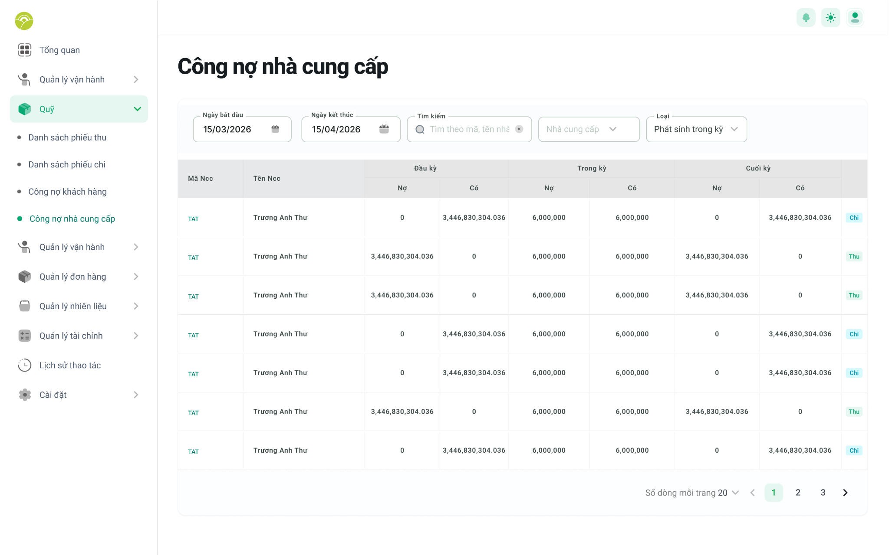
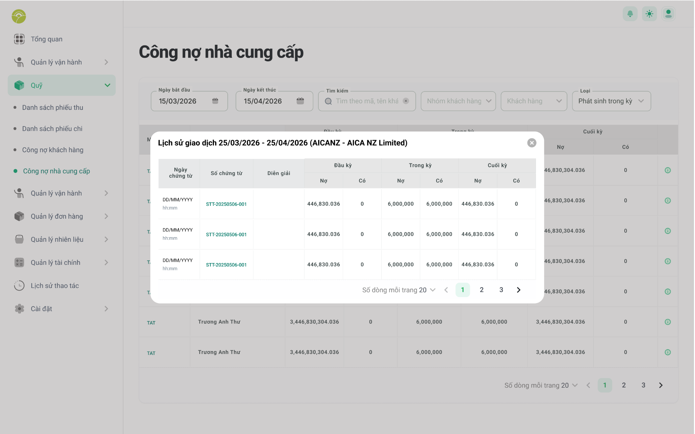

## TÀI LIỆU ĐẶC TẢ YÊU CẦU PHẦN MỀM (SRS)

Tên dự án: TMS – Transportation Management System

Module: Công nợ nhà cung cấp

Phiên bản tài liệu: v1.0

### Lịch sử thay đổi (Revision History)

| Phiên bản | Ngày | Người thực hiện | Nội dung thay đổi |
|---|---|---|---|
| v1.0 | 22/08/2026 | Thư | Khởi tạo tài liệu |

### 1. GIỚI THIỆU (Introduction)

#### 1.1. Mục đích tài liệu

Tài liệu SRS này đặc tả yêu cầu chức năng cho module Công nợ nhà cung cấp thuộc hệ thống TMS (Transportation Management System). Tài liệu tập trung mô tả chi tiết từng field trên giao diện, quy tắc nghiệp vụ, và luồng xử lý — làm cơ sở cho team Dev (FE/BE), QC và các bên liên quan.

#### 1.2. Phạm vi hệ thống (Scope)

In-scope:

Màn hình danh sách Công nợ nhà cung cấp (bảng tổng hợp công nợ theo từng NCC)

Popup Lịch sử giao dịch chi tiết theo NCC (hiển thị các transaction từ phiếu chi thanh toán NCC và đơn thuê vận chuyển hoàn thành)

Bộ lọc theo khoảng thời gian, tìm kiếm NCC, lọc theo nhóm NCC, và loại phát sinh

Out-of-scope:

Tạo mới / chỉnh sửa phiếu chi (đã có SRS riêng)

Tạo mới / chỉnh sửa đơn thuê vận chuyển (đã có SRS riêng)

Quản lý danh mục nhà cung cấp

Công nợ khách hàng (module riêng)

#### 1.3. Thuật ngữ & viết tắt (Glossary)

| Thuật ngữ | Định nghĩa |
|---|---|
| NCC | Nhà cung cấp (Supplier/Partner) — đối tác thuê ngoài vận chuyển |
| Công nợ | Số tiền phải trả/đã trả cho NCC, tính theo nguyên tắc Nợ - Có (ghi sổ kép) |
| Phiếu chi | Chứng từ ghi nhận khoản thanh toán cho NCC (payment voucher), chỉ tính phiếu chi có type = "Thanh toán nhà cung cấp" |
| Đơn thuê vận chuyển (Subcontract) | Đơn thuê NCC vận chuyển hàng, ghi nhận phát sinh công nợ khi chỉ thị giao hàng (DI) thuộc đơn thuê ngoài có trạng thái hoàn thành |
| Chỉ thị giao hàng (DI) | Delivery Instruction — chỉ thị vận chuyển cụ thể. Chỉ DI có vehicle_type = 'external' (đơn thuê ngoài) và trạng thái hoàn thành mới phát sinh công nợ NCC |
| Đầu kỳ | Số dư công nợ tại thời điểm bắt đầu khoảng thời gian lọc (trước ngày bắt đầu) |
| Trong kỳ | Tổng phát sinh Nợ và Có trong khoảng thời gian lọc |
| Cuối kỳ | Số dư công nợ tại thời điểm kết thúc khoảng thời gian lọc. Cuối kỳ = Đầu kỳ + Trong kỳ |
| Nợ | Phát sinh tăng công nợ (NCC cung cấp dịch vụ → phát sinh chi phí phải trả) |
| Có | Phát sinh giảm công nợ (thanh toán cho NCC qua phiếu chi) |

### 2. MÔ TẢ TỔNG QUAN (Overall Description)

#### 2.1. Bối cảnh nghiệp vụ

Hệ thống TMS quản lý vận tải, trong đó có nghiệp vụ thuê ngoài vận chuyển (subcontract). Khi một chỉ thị giao hàng (DI) thuộc loại đơn thuê ngoài (vehicle_type = 'external') chuyển sang trạng thái hoàn thành, hệ thống ghi nhận phát sinh Nợ (chi phí phải trả NCC). Khi kế toán tạo phiếu chi có type "Thanh toán nhà cung cấp" để thanh toán cho NCC, hệ thống ghi nhận phát sinh Có (giảm công nợ).

Module Công nợ nhà cung cấp tổng hợp toàn bộ giao dịch này theo từng NCC, cho phép xem số dư đầu kỳ, phát sinh trong kỳ, và số dư cuối kỳ trong khoảng thời gian tùy chọn. Người dùng có thể click vào từng dòng NCC để xem chi tiết lịch sử giao dịch (popup).

#### 2.2. Đối tượng người dùng

| Vai trò | Mô tả | Quyền hạn chính |
|---|---|---|
| Admin | Quản trị hệ thống | Full quyền — xem, lọc, xuất báo cáo công nợ NCC |
| Kế toán | Nhân viên kế toán vận tải | Xem, lọc công nợ NCC, xem chi tiết lịch sử giao dịch |

#### 2.3. Giả định & ràng buộc

Giả định:

Danh mục NCC (bảng customer với vai trò supplier) đã được thiết lập

Phiếu chi thanh toán NCC đã có module riêng và ghi nhận customer_id (NCC) tương ứng

Đơn thuê vận chuyển (subcontract) và chỉ thị giao hàng (delivery_instruction) đã có module riêng

Ràng buộc:

Chỉ ghi nhận phát sinh Nợ từ DI có vehicle_type = 'external' và trạng thái hoàn thành

Chỉ ghi nhận phát sinh Có từ phiếu chi có type = "Thanh toán nhà cung cấp"

Module này là read-only (chỉ xem báo cáo, không tạo/sửa/xóa dữ liệu)

Phụ thuộc:

Module Phiếu chi (payment voucher)

Module Đơn thuê vận chuyển (subcontract)

Module Chỉ thị giao hàng (delivery instruction)

### 3. YÊU CẦU CHỨC NĂNG (Functional Requirements)

#### 3.1. Màn hình: Danh sách Công nợ nhà cung cấp

 

##### 3.1.1. Mô tả nghiệp vụ (Business Description)

Màn hình tổng hợp công nợ của tất cả nhà cung cấp trong khoảng thời gian được chọn. Mỗi dòng đại diện cho một NCC, hiển thị số dư đầu kỳ (Nợ/Có), phát sinh trong kỳ (Nợ/Có), và số dư cuối kỳ (Nợ/Có). Cột cuối cùng hiển thị loại giao dịch (Thu/Chi) tùy thuộc vào chiều dư nợ.

Người dùng truy cập từ sidebar: .

##### 3.1.2. User Story

Là Kế toán, tôi muốn xem tổng hợp công nợ từng nhà cung cấp theo khoảng thời gian để theo dõi số tiền phải trả, đã trả và còn lại cho từng NCC.

##### 3.1.3. Luồng xử lý (User Flow)

Luồng chính — Xem danh sách:

Người dùng truy cập menu .

Hệ thống hiển thị màn hình danh sách với bộ lọc mặc định: Ngày bắt đầu = ngày đầu tháng hiện tại, Ngày kết thúc = ngày hiện tại, Loại = "Phát sinh trong kỳ".

Hệ thống tự động load danh sách công nợ NCC theo bộ lọc mặc định.

Người dùng có thể thay đổi bộ lọc (ngày, NCC, nhóm NCC, loại phát sinh) → hệ thống reload dữ liệu tương ứng.

Popup Lịch sử giao dịch chi tiết của NCC đó.

Luồng ngoại lệ:

Khoảng thời gian không hợp lệ (Ngày kết thúc < Ngày bắt đầu) → toast lỗi "Ngày kết thúc phải lớn hơn hoặc bằng ngày bắt đầu".

##### 3.1.4. Đặc tả giao diện (UI Specification)

Bộ lọc (Filter Bar):

| # | Field | Mô tả chi tiết |
|---|---|---|
| 1 | Ngày bắt đầu | Date picker. Mặc định: ngày đầu tháng hiện tại.  Format: DD/MM/YYYY. Khi thay đổi → trigger reload bảng. |
| 2 | Ngày kết thúc | Date picker. Mặc định: ngày hiện tại.  Format: DD/MM/YYYY.  Khi thay đổi → trigger reload bảng.  Phải ≥ Ngày bắt đầu. |
| 3 | Tìm kiếm | Textbox search.  Placeholder: "Tìm theo mã, tên nhà cung cấp". Tìm kiếm theo customer.code hoặc customer.name. Có nút (x) để xóa text. Trigger tìm kiếm khi nhập (debounce) hoặc nhấn Enter. |
| 4 | Nhà cung cấp | Dropdown (searchable). Source: bảng customer (chỉ lấy NCC — partner có subcontract). Placeholder: "Nhà cung cấp". Cho phép chọn 1 NCC cụ thể để lọc. |
| 5 | Loại | Cho phép người dùng lựa chọn phạm vi nhà cung cấp cần hiển thị dữ liệu. Dropdown gồm các giá trị: Phát sinh trong kỳ (mặc định): Hiển thị các nhà cung cấp có phát sinh giao dịch trong khoảng thời gian được chọn. Công nợ cuối kỳ: Hiển thị các nhà cung cấp có số dư công nợ tại thời điểm cuối kỳ. Tất cả nhà cung cấp: Hiển thị toàn bộ nhà cung cấp đang có trên hệ thống, không phụ thuộc vào việc có phát sinh giao dịch hoặc công nợ trong kỳ. |

Bảng danh sách (Table):

| # | Tên cột | Mô tả chi tiết |
|---|---|---|
| 1 | Mã Ncc | Hiển thị mã khách hàng có type là NCC.   |
| 2 | Tên Ncc | Hiển thị tên khách hàng có type là NCC.   |
| 3 | Đầu kỳ — Nợ | Mô tả: Hiển thị số dư bên Nợ của tài khoản tại thời điểm đầu kỳ (trước ngày bắt đầu kỳ báo cáo). Công thức:Hệ thống tính tổng tất cả thành tiền phát sinh bên Nợ và tổng tất cả các thành tiền phát sinh bên Có của khách hàng Chỉ xét các giao dịch có ngày tạo phiếu nằm trước ngày bắt đầu kỳ báo cáo. Nếu tổng phát sinh Nợ > tổng phát sinh Có  Nếu tổng phát sinh Nợ Có |
| 4 | Đầu kỳ — Có | Mô tả: Hiển thị số dư bên Có của tài khoản tại thời điểm đầu kỳ (trước ngày bắt đầu kỳ báo cáo). Công thức: Hệ thống tính tổng tất cả thành tiền phát sinh bên Có và tổng tất cả các thành tiền phát sinh bên Nợ của tài khoản Chỉ xét các giao dịch có ngày tạo  nằm trước ngày bắt đầu kỳ báo cáo. Nếu tổng phát sinh Có >  tổng phát sinh Nợ  Nếu tổng phát sinh Có Nợ |
| 5 | Trong kỳ — Nợ | Mô tả: Hiển thị tổng giá trị các khoản đã thanh toán cho nhà cung cấp trong kỳ báo cáo. Nguồn dữ liệu lấy từ các phiếu chi có loại (type) là "thanh toán nhà cung cấp". Công thức:Hệ thống lọc tất cả các phiếu chi thỏa đồng thời hai điều kiện: Phiếu chi có type = thanh toán nhà cung cấp, và thuộc nhà cung cấp đang xét. Ngày tạo phiếu chi nằm trong khoảng thời gian lọc (từ ngày bắt đầu đến ngày kết thúc kỳ báo cáo). Sau đó tính tổng giá trị của các phiếu chi thỏa điều kiện trên.    |
| 6 | Trong kỳ — Có | Mô tả:Hiển thị tổng giá trị công nợ phát sinh bên Có của nhà cung cấp trong kỳ báo cáo. Nguồn dữ liệu lấy từ các Delivery Invoice (DI) thuê ngoài đã hoàn thành. Công thức:Hệ thống lọc tất cả các Delivery Invoice (DI) thỏa đồng thời các điều kiện sau: DI có loại là thuê ngoài. DI đã ở trạng thái hoàn thành. DI thuộc subcontract của nhà cung cấp đang xét. Ngày hạch toán của DI nằm trong khoảng thời gian lọc (từ ngày bắt đầu đến ngày kết thúc kỳ báo cáo). Sau đó tính tổng thành tiền của các DI thỏa điều kiện trên.    |
| 7 | Cuối kỳ — Nợ | Mô tả: Hiển thị số dư bên Nợ của nhà cung cấp tại thời điểm cuối kỳ báo cáo (tính đến ngày kết thúc bộ lọc). Công thức: Hệ thống tính số dư cuối kỳ theo công thức: Cuối kỳ = Đầu kỳ Nợ + Trong kỳ Nợ − Đầu kỳ Có − Trong kỳ Có Nếu kết quả dương (> 0) → hiển thị giá trị đó tại cột Cuối kỳ Nợ (Hiển thị số dương)  |
| 8 | Cuối kỳ — Có | Mô tả: Hiển thị số dư bên Có của nhà cung cấp tại thời điểm cuối kỳ báo cáo (tính đến ngày kết thúc bộ lọc). Công thức: Hệ thống tính số dư cuối kỳ theo công thức: Cuối kỳ = Đầu kỳ Nợ + Trong kỳ Nợ − Đầu kỳ Có − Trong kỳ Có Nếu kết quả âm (< 0) → hiển thị giá trị tuyệt đối tại cột Cuối kỳ Có (Hiển thị số dương)   |
| 9 | Loại (Thu/Chi) | Badge ở cột cuối + "Thu": NCC còn dư Nợ cuối kỳ + "Chi": NCC dư Có cuối kỳ |

Lưu ý chung: Hai cột Đầu kỳ Nợ và Đầu kỳ Có hoạt động theo nguyên tắc loại trừ — trên cùng mộtnhà cung cấp, tại cùng một thời điểm, chỉ một trong hai cột có giá trị lớn hơn 0, cột còn lại luôn bằng 0 hoặc ngược lại

##### 3.1.5. Quy tắc nghiệp vụ (Business Rules)

| Mã | Tên quy tắc | Quy tắc |
|---|---|---|
| BR-CNNCC-001 | Badge Thu/Chi | Cuối kỳ Nợ"Thu".  Cuối kỳ Có"Chi".   |
| BR-CNNCC-002 | Lọc "Phát sinh trong kỳ" | Chỉ hiển thị NCC có ít nhất 1 giao dịch (Nợ hoặc Có trong kỳ) trong khoảng thời gian lọc.   |
| BR-CNNCC-003 | Lọc "Tất cả" | Hiển thị tất cả NCC |

#### 3.2. Popup: Lịch sử giao dịch NCC

 

##### 3.2.1. Mô tả nghiệp vụ (Business Description)

Popup hiển thị danh sách chi tiết từng giao dịch phát sinh công nợ của một NCC cụ thể trong khoảng thời gian đã chọn trên bộ lọc chính. Mỗi dòng là một chứng từ (phiếu chi thanh toán NCC hoặc lệnh điều xe gắn DI thuê ngoài hoàn thành), hiển thị số chứng từ, diễn giải, số dư đầu kỳ/trong kỳ/cuối kỳ tính lũy kế theo dòng.

##### 3.2.2. User Story

Là Kế toán, tôi muốn xem chi tiết lịch sử giao dịch công nợ của từng nhà cung cấp để đối chiếu từng chứng từ phát sinh Nợ/Có và kiểm tra số dư.

##### 3.2.3. Luồng xử lý (User Flow)

Luồng chính — Mở popup lịch sử:

Từ màn hình Danh sách Công nợ NCC, người dùng click vào Mã NCC (link) hoặc dòng bất kỳ trong bảng.

Hệ thống mở Popup với tiêu đề: Lịch sử giao dịch DD/MM/YYYY - DD/MM/YYYY (MÃ_NCC - Tên NCC) — trong đó DD/MM/YYYY là khoảng thời gian từ bộ lọc chính.

Hệ thống load danh sách giao dịch chi tiết của NCC đó, sắp xếp theo ngày chứng từ tăng dần.

Mỗi dòng hiển thị: Ngày chứng từ, Số chứng từ (link), Diễn giải, Đầu kỳ (Nợ/Có), Trong kỳ (Nợ/Có), Cuối kỳ (Nợ/Có).

Người dùng click Số chứng từ (link) → navigate đến màn hình chi tiết chứng từ gốc (phiếu chi hoặc đơn thuê vận chuyển).

Người dùng click nút Đóng (X) → đóng popup, quay lại danh sách.

Luồng ngoại lệ:

##### 3.2.4. Đặc tả giao diện (UI Specification)

Bảng lịch sử giao dịch (Table):

| # | Tên cột | Mô tả chi tiết |
|---|---|---|
| 1 | Ngày chứng từ | Ngày phát sinh giao dịch. Format: DD/MM/YYYY hh:mm.  Phiếu chi: lấy ngày phiếu chi. DI thuê ngoài: lấy “ngày hoàn thành” của DI |
| 2 | Số chứng từ | Mã chứng từ. + Phiếu chi: hiển thị mã phiếu chi (VD: STT-20250506-001).  + DI: hiển thị mã lệnh điều xe.  |
| 3 | Diễn giải | Mô tả giao dịch. Phiếu chi: lấy description của phiếu chi.  Phiếu DI: lấy description hoặc ghi nhận tự động |
| 4 | Đầu kỳ — Nợ | Số dư Nợ đầu kỳ.  Dòng đầu tiên = Đầu kỳ Nợ từ bảng chính.  Các dòng sau = Cuối kỳ Nợ của dòng trước.  Format: số có dấu phân cách nghìn. |
| 5 | Đầu kỳ — Có | Số dư Có đầu kỳ.  Logic tương tự cột Đầu kỳ Nợ nhưng cho phía Có. |
| 6 | Trong kỳ — Nợ | Phát sinh Nợ của giao dịch này.  Nếu giao dịch là phiếu chi |
| 7 | Trong kỳ — Có | Phát sinh Có của giao dịch này.  Nếu giao dịch là DI thuê ngoài hoàn thành → hiển thị thành tiền hoàn thành (Số lượng giao hàng * đơn giá của đơn thuê ngoài)  |
| 8 | Cuối kỳ — Nợ | Cuối kỳ Nợ = Đầu kỳ Nợ + Trong kỳ Nợ − Đầu kỳ Có − Trong kỳ Có.    |
| 9 | Cuối kỳ — Có | Cuối kỳ Có = Đầu kỳ Nợ + Trong kỳ Nợ − Đầu kỳ Có − Trong kỳ Có.  Nếu kết quả âm (< 0) → hiển thị giá trị tuyệt đối.   |

##### 3.2.5. Quy tắc nghiệp vụ (Business Rules)

| Mã | Quy tắc |
|---|---|
| BR-CNNCC-010 | Sắp xếp giao dịch: Các giao dịch được sắp xếp theo ngày chứng từ tăng dần |
| BR-CNNCC-011 | Tính lũy kế theo dòng: Mỗi dòng giao dịch tính số dư cuối kỳ dựa trên đầu kỳ + phát sinh.  Đầu kỳ của dòng N = Cuối kỳ của dòng N-1.  Đầu kỳ dòng đầu tiên = số dư đầu kỳ tổng của NCC (giống giá trị ở bảng chính). |
| BR-CNNCC-012 | Link chứng từ: Click vào Số chứng từ → nếu là phiếu chi → navigate đến chi tiết phiếu  Nếu là lệnh điều xe (dispatch order) → navigate đến chi tiết phiếu |
| BR-CNNCC-013 | Xác định loại giao dịch:   Giao dịch từ DI thuê ngoài hoàn thành → ghi nhận Nợ (tăng công nợ). |
| BR-CNNCC-014 | Khoảng thời gian popup: Kế thừa từ bộ lọc chính (Ngày bắt đầu / Ngày kết thúc). Popup không có bộ lọc thời gian riêng. |

### 4. YÊU CẦU DỮ LIỆU (Data Requirements)

#### 4.1. Mô hình dữ liệu (Data Model)

#### 4.2. Từ điển dữ liệu (Data Dictionary)

Bảng: customer (đã tồn tại trong DB — vai trò NCC/Supplier)

| Trường | Kiểu dữ liệu | Bắt buộc | Mô tả |
|---|---|---|---|
| id | varchar (PK) | Có | UUID, khóa chính |
| code | varchar | Có | Mã NCC |
| name | varchar | Có | Tên NCC |
| groups | jsonb | Có | Nhóm NCC (dùng cho bộ lọc "Nhóm khách hàng") |
| is_deleted | boolean | Có | Default: false. Soft delete |

Bảng: subcontract (đã tồn tại trong DB)

| Trường | Kiểu dữ liệu | Bắt buộc | Mô tả |
|---|---|---|---|
| id | varchar (PK) | Có | UUID, khóa chính |
| code | varchar | Có | Mã đơn thuê vận chuyển |
| status | varchar | Có | Trạng thái: New, Canceled |
| date | timestamptz | Có | Ngày đơn thuê |
| partner_id | varchar (FK) | Có | customer.id. NCC liên kết |
| total_amount | numeric | Có | Tổng giá trị đơn thuê |

Bảng: delivery_instruction (đã tồn tại trong DB)

| Trường | Kiểu dữ liệu | Bắt buộc | Mô tả |
|---|---|---|---|
| id | varchar (PK) | Có | UUID, khóa chính |
| code | varchar | Có | Mã chỉ thị giao hàng |
| status | varchar | Có | Trạng thái: New, Dispatched, Canceled. (Cần bổ sung status Completed cho logic công nợ) |
| vehicle_type | varchar | Không | Loại xe: internal (nội bộ), external (thuê ngoài). Chỉ external phát sinh công nợ NCC. |
| subcontract_id | varchar (FK) | Không | subcontract.id. Liên kết đơn thuê. Chỉ có khi vehicle_type = 'external'. |
| delivery_order_id | varchar (FK) | Có | delivery_order.id |

Bảng: dispatch_order (đã tồn tại trong DB)

| Trường | Kiểu dữ liệu | Bắt buộc | Mô tả |
|---|---|---|---|
| id | varchar (PK) | Có | UUID, khóa chính |
| code | varchar | Có | Mã lệnh điều xe |
| status | varchar | Có | Trạng thái: Delivery, Completed, Canceled |
| delivery_instruction_id | varchar (FK) | Có | delivery_instruction.id |
| total_amount | numeric | Có | Tổng chi phí lệnh điều xe. Default: 0 |
| paid | numeric | Có | Số tiền đã thanh toán. Default: 0 |
| remaining | numeric | Có | Số tiền còn lại. Default: 0 |
| payment_status | varchar | Có | Trạng thái thanh toán: Unpaid. Default: 'Unpaid' |

Bảng: customer_receipt (đã tồn tại trong DB — dùng cho phiếu chi/phiếu thu)

| Trường | Kiểu dữ liệu | Bắt buộc | Mô tả |
|---|---|---|---|
| id | varchar (PK) | Có | UUID, khóa chính |
| code | varchar | Có | Mã phiếu chi (VD: STT-20250506-001) |
| date | timestamptz | Có | Ngày phiếu chi |
| value | numeric | Có | Giá trị thanh toán |
| description | varchar | Không | Diễn giải phiếu chi |
| customer_id | varchar (FK) | Có | customer.id. NCC được thanh toán |
| payment_method_id | varchar (FK) | Có | payment_method.id |
| is_deleted | boolean | Có | Default: false. Soft delete |

Bảng: payment_method (đã tồn tại trong DB)

| Trường | Kiểu dữ liệu | Bắt buộc | Mô tả |
|---|---|---|---|
| id | varchar (PK) | Có | UUID, khóa chính |
| name | varchar | Có | Tên phương thức thanh toán |
| type | varchar | Có | Loại: cash, bank |
| bank_id | varchar (FK) | Không | bank.id. Chỉ có khi type = 'bank' |
| account_no | varchar | Không | Số tài khoản ngân hàng |
| account_name | varchar | Không | Tên chủ tài khoản |