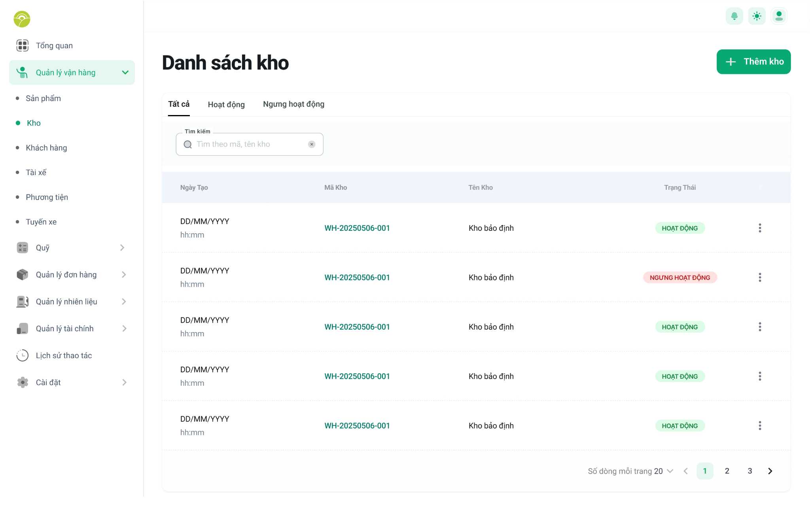
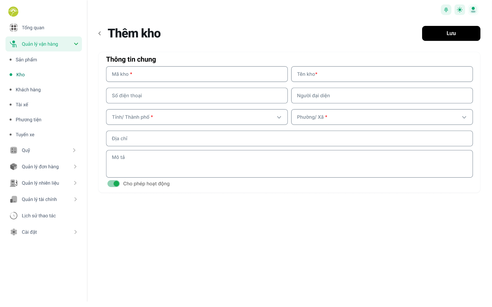
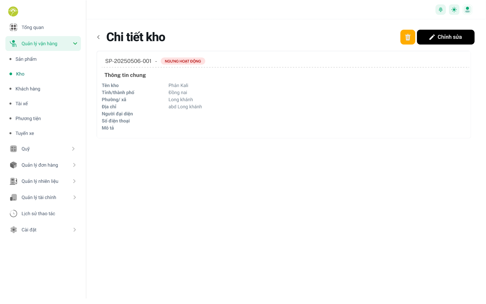
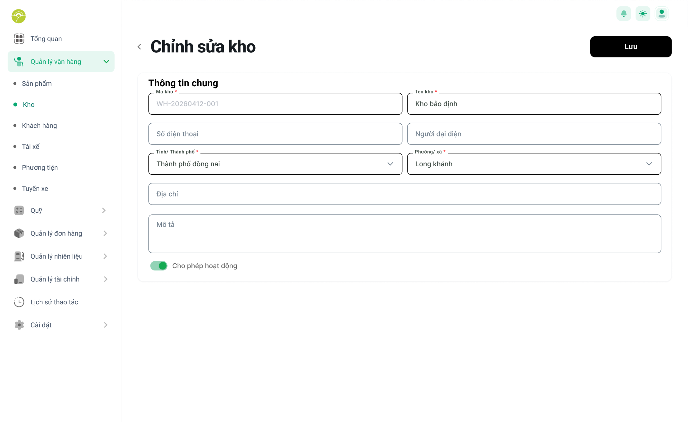

## TÀI LIỆU ĐẶC TẢ YÊU CẦU PHẦN MỀM (SRS)

Tên dự án: TMS – Transportation Management System

Module: Quản lý kho (Warehouse Management)

### Lịch sử thay đổi (Revision History)

| Phiên bản | Ngày | Người thực hiện | Nội dung thay đổi |
|---|---|---|---|
| v1.0 | 18/07/2026 | Thư | Khởi tạo tài liệu |

### 1. GIỚI THIỆU (Introduction)

#### 1.1. Mục đích tài liệu

Tài liệu SRS này đặc tả yêu cầu chức năng và phi chức năng cho module Quản lý kho thuộc hệ thống TMS (Transportation Management System). Tài liệu là cơ sở cho team Dev (FE/BE), QC và các bên liên quan trong quá trình phát triển, kiểm thử và nghiệm thu.

#### 1.2. Phạm vi hệ thống (Scope)

In-scope:

Màn hình Danh sách kho (Warehouse List) với tab lọc trạng thái

Màn hình Thêm kho (Create Warehouse)

Màn hình Chi tiết kho (Warehouse Detail — view only)

Màn hình Sửa kho (Edit Warehouse)

Xoá kho (soft delete) từ màn Chi tiết

Tìm kiếm kho theo mã kho

Sắp xếp danh sách theo cột

Bật/tắt trạng thái hoạt động của kho

Out-of-scope:

Quản lý tồn kho / inventory trong kho

Import/Export danh sách kho hàng loạt

Bản đồ vị trí kho (map integration)

Quản lý phân khu / khu vực trong kho

#### 1.5. Tài liệu tham chiếu

| Tài liệu | Link / Vị trí | Ghi chú |
|---|---|---|
| Figma Design | [link] | Màn hình Danh sách, Chi tiết, Thêm & Sửa kho |

### 2. MÔ TẢ TỔNG QUAN (Overall Description)

#### 2.1. Bối cảnh & vấn đề (Business Context)

Trong hệ thống TMS, kho là dữ liệu danh mục (master data) đại diện cho các điểm kho hàng — nơi xuất phát hoặc tiếp nhận hàng hoá trong tuyến vận chuyển. Kho được tham chiếu trong bảng route (tuyến đường) với vai trò kho xuất phát (origin_warehouse_id) hoặc kho đích (destination_warehouse_id).

Người dùng cần quản lý thông tin kho bao gồm: mã kho, tên kho, địa chỉ (tỉnh/thành phố, phường/xã, địa chỉ chi tiết), thông tin người đại diện, và trạng thái hoạt động. Hệ thống hỗ trợ tìm kiếm, lọc theo trạng thái, và bật/tắt hoạt động của kho.

#### 2.2. Đối tượng người dùng (User Personas)

| Vai trò (Role) | Mô tả | Quyền hạn chính |
|---|---|---|
| Admin | Quản trị viên hệ thống TMS | Full quyền: xem, thêm, sửa, xoá, bật/tắt trạng thái kho |
| Nhân viên vận hành | Người dùng nghiệp vụ vận tải | Xem danh sách, thêm mới, chỉnh sửa kho |

### 3. YÊU CẦU CHỨC NĂNG (Functional Requirements)

#### 3.1. Màn hình: Danh sách kho (Warehouse List)

##### 3.1.1. Mô tả nghiệp vụ (Business Description)

Màn hình hiển thị danh sách toàn bộ kho trong hệ thống dưới dạng bảng. Phía trên bảng có 3 tab lọc theo trạng thái: Tất cả, Hoạt động, Ngưng hoạt động. Người dùng có thể tìm kiếm theo mã kho, sắp xếp theo từng cột, và truy cập nhanh vào trang thêm mới kho.

Đường dẫn truy cập: Sidebar → Vận Hành → [Submenu] → Danh sách kho

 

##### 3.1.2. User Story

Là nhân viên vận hành, tôi muốn xem danh sách tất cả kho hàng, lọc theo trạng thái hoạt động, và tìm kiếm nhanh theo mã kho để tra cứu thông tin kho khi cần tạo tuyến vận chuyển hoặc đơn hàng.

##### 3.1.3. Luồng xử lý (User Flow)

##### 3.1.4. Đặc tả giao diện (UI Specification)

Tabs lọc trạng thái:

| # | Tab | Mô tả |
|---|---|---|
| 1 | Tất cả | Hiển thị toàn bộ kho. Tab mặc định khi vào trang. |
| 2 | Hoạt động | Chỉ hiển thị kho có is_active = true |
| 3 | Ngưng hoạt động | Chỉ hiển thị kho có is_active = false |

Thanh tìm kiếm (Search bar):

| # | Thành phần (Component) | Loại | Bắt buộc | Mô tả / Validation |
|---|---|---|---|---|
| 1 | Tìm kiếm kho | Search Input | Không | Placeholder: "Tìm theo mã và tên sản phẩm".  Có icon search bên trái, icon clear (x) khi có nội dung.  Tìm kiếm trên cả mã và tên kho |

Bảng danh sách (Data Table):

| # | Cột (Column) | Kiểu hiển thị | Sắp xếp | Mô tả |
|---|---|---|---|---|
| 1 | Ngày tạo | Text (DD/MM/YYYY HH:mm) | Có (↑↓) | Hiển thị created_at, format: DD/MM/YYYY dòng trên, HH:mm dòng dưới. Mặc định sort DESC. |
| 2 | Mã kho | Text (link style, màu xanh) | Có (↑↓) | Hiển thị code. Click → mở màn hình Chi tiết kho. |
| 3 | Tên kho | Text | Có (↑↓) | Hiển thị name. |
| 4 | Trạng thái | Badge/Tag | Có (↑↓) | Hiển thị trạng thái dựa trên is_active:  + true → badge "Hoạt động" (màu xanh lá) + false → badge "Ngưng hoạt động" (màu đỏ). |

Phân trang (Pagination):

| # | Thành phần | Mô tả |
|---|---|---|
| 1 | Phân trang | Mặc định 20 bản ghi/trang. Nút Previous / Next và chọn số trang. |

Nút hành động (Action Buttons):

| # | Nút | Vị trí | Mô tả |
|---|---|---|---|
| 1 | + Thêm Kho | Góc trên bên phải (header) | Button primary, nền xanh lá, chữ trắng. Click → màn hình Thêm kho. |

##### 3.1.5. Quy tắc nghiệp vụ (Business Rules)

| Mã | Quy tắc |
|---|---|
| BR-WH-001 | Danh sách chỉ hiển thị kho có is_deleted = false thuộc tenant hiện tại. |
| BR-WH-002 | Sắp xếp mặc định: created_at DESC (mới nhất lên trước). |
| BR-WH-003 | Tìm kiếm không phân biệt hoa/thường (case-insensitive), tìm trên search_code. |
| BR-WH-004 | Tab lọc trạng thái kết hợp với search keyword: kết quả phải thoả mãn cả hai điều kiện. |
| BR-WH-005 | Mã kho trong bảng hiển thị dạng link — click để mở Chi tiết kho. |
| BR-WH-006 | Trạng thái "Hoạt động" hiển thị badge xanh lá, "Ngưng hoạt động" hiển thị badge đỏ/cam. |

##### 3.1.6. Đặc tả API (dành cho BE)

| # | Endpoint | Method | Mô tả |
|---|---|---|---|
| 1 | /api/v1/warehouses/list | POST | Lấy danh sách kho, hỗ trợ search, filter, sort, paging |

Query Params:

| Trường | Kiểu | Bắt buộc | Mô tả |
|---|---|---|---|
| pageIndex | integer | Có | Trang hiện tại (bắt đầu từ 1). Default: 1 |
| pageSize | integer | Có | Số bản ghi mỗi trang. Default: 20 |
| startDate | string (ISO 8601) \| null | Không | Lọc theo ngày tạo — từ ngày. Format: yyyy-MM-ddTHH:mm:ss.SSSZ. Null = không lọc |
| endDate | string (ISO 8601) \| null | Không | Lọc theo ngày tạo — đến ngày. Format: yyyy-MM-ddTHH:mm:ss.SSSZ. Null = không lọc |
| isCount | boolean | Có | true = response trả kèm tổng số bản ghi (phục vụ phân trang). Default: true |
| isAll | boolean | Có | true = lấy toàn bộ bản ghi (bỏ qua phân trang).  Default: false |
| searchText | string | Không | Từ khoá tìm kiếm, match trên search_code và search_name (case-insensitive).  Rỗng = không lọc |
| sort | object | Không | Object chứa thông tin sắp xếp |
| sort.sortDirection | string | Không | Chiều sắp xếp: ASC, DESC, hoặc None.  Default: DESC |
| sort.sortPropertyName | string | Không | Tên cột sắp xếp: createdAt, code, name.  Default: createdAt |
| isActive | boolean | Không | Lọc theo trạng thái hoạt động. true = Hoạt động, false = Ngưng hoạt động, null = Tất cả (tab "Tất cả") |

Chi tiết Response Body:

| Trường | Kiểu | Mô tả |
|---|---|---|
| id | string (UUID) | ID kho |
| code | string | Mã kho |
| name | string | Tên kho |
| shortName | string \| null | Tên viết tắt kho |
| rovince | object \| null | Thông tin tỉnh/thành phố (đã resolve từ mã) |
| items[].province.code | string | Mã hành chính tỉnh/TP |
| items[].province.name | string | Tên tỉnh/TP |
| items[].province.shortName | string | Tên viết tắt tỉnh/TP |
| items[].commune | object \| null | Thông tin phường/xã (đã resolve từ mã) |
| items[].commune.code | string | Mã hành chính phường/xã |
| items[].commune.name | string | Tên phường/xã |
| items[].commune.shortName | string | Tên viết tắt phường/xã |
| items[].address | string \| null | Địa chỉ chi tiết |
| items[].contactName | string \| null | Tên người đại diện |
| items[].contactPhone | string \| null | Số điện thoại liên hệ |
| items[].description | string \| null | Mô tả kho |
| items[].isActive | boolean | Trạng thái hoạt động (true = Hoạt động, false = Ngưng hoạt động) |
| items[].createdAt | string (ISO 8601) | Thời điểm tạo. FE format hiển thị: DD/MM/YYYY dòng trên, HH:mm dòng dưới |
| totalCount | integer | Tổng số bản ghi (chỉ trả khi isCount = true) |

Error Codes:

| HTTP Code | Error Code | Message | Trường hợp |
|---|---|---|---|
| 401 | ERR_UNAUTHORIZED | Phiên đăng nhập hết hạn | Token không hợp lệ hoặc hết hạn |
| 403 | ERR_FORBIDDEN | Không có quyền truy cập | User không có quyền xem kho |
| 500 | ERR_INTERNAL | Lỗi hệ thống | Lỗi server không xác định |

#### 3.2. Màn hình: Thêm kho (Create Warehouse)

##### 3.2.1. Mô tả nghiệp vụ (Business Description)

Màn hình cho phép người dùng thêm mới một kho vào hệ thống. Form gồm các trường: mã kho (bắt buộc), tên kho (bắt buộc), số điện thoại, người đại diện, tỉnh/thành phố (bắt buộc), phường/xã (bắt buộc), địa chỉ, mô tả, và toggle cho phép hoạt động. Sau khi lưu thành công, kho xuất hiện trong danh sách.

Đường dẫn: Danh sách kho → Nút "+ Thêm Kho" → Màn hình Thêm kho

 

##### 3.2.2. User Story

Là nhân viên vận hành, tôi muốn thêm mới kho hàng với đầy đủ thông tin vị trí và liên hệ để sử dụng kho trong việc tạo tuyến vận chuyển và đơn hàng.

##### 3.2.3. Luồng xử lý (User Flow)

##### 3.2.4. Đặc tả giao diện (UI Specification)

Form nhập liệu — Section "Thông tin chung":

| # | Thành phần (Component) | Loại | Bắt buộc | Mô tả / Validation |
|---|---|---|---|---|
| 1 | Mã kho | Textbox | Có (*) | Placeholder: "Mã kho".Unique per tenant. Lưu vào code và search_code. |
| 2 | Tên kho | Textbox | Có (*) | Placeholder: "Tên kho".  Lưu vào name và search_name. |
| 3 | Số điện thoại | Textbox | Không | Placeholder: "Số điện thoại".  Lưu vào contact_phone và search_contact_phone. |
| 4 | Người đại diện | Textbox | Không | Placeholder: "Người đại diện".  Lưu vào contact_name và search_contact_name. |
| 5 | Tỉnh/Thành Phố | Dropdown | Có (*) | Placeholder: "Tỉnh/Thành Phố".  Load danh sách từ API danh mục hành chính. Lưu mã code vào province. |
| 6 | Phường/Xã | Dropdown | Có (*) | Placeholder: "Phường/Xã".  Cascade từ Tỉnh/Thành Phố — chỉ hiển thị phường/xã thuộc tỉnh đã chọn.  Lưu mã code vào commune.  Disable khi chưa chọn Tỉnh/Thành Phố. |
| 7 | Địa chỉ | Textbox | Không | Placeholder: "Địa chỉ".  Địa chỉ chi tiết (số nhà, đường, quốc lộ...). Lưu vào address. |
| 8 | Mô tả | Textarea | Không | Placeholder: "Mô tả". Multi-line.  Lưu vào description. |
| 9 | Cho phép hoạt động | Toggle Switch | — | Mặc định: ON (bật). +ON → is_active = true,  +OFF → is_active = false. |

##### 3.2.5. Quy tắc nghiệp vụ (Business Rules)

| Mã | Quy tắc |
|---|---|
| BR-WH-007 | Mã kho (code) là duy nhất trong cùng tenant. Kiểm tra trùng lặp trước khi lưu. |
| BR-WH-008 | Khi tạo kho, toggle "Cho phép hoạt động" mặc định ON → is_active = true. |
| BR-WH-009 | Dropdown Phường/Xã cascade từ Tỉnh/Thành Phố: khi đổi tỉnh → reset phường/xã. Khi chưa chọn tỉnh → dropdown phường/xã disable. |
| BR-WH-010 | Trường province và commune lưu mã hành chính (không lưu tên hiển thị). FE chịu trách nhiệm resolve mã → tên qua API danh mục. |
| BR-WH-011 | Trường search_code, search_name, search_contact_name, search_contact_phone được tạo tự động (lowercase, bỏ dấu) từ trường gốc tương ứng. |
| BR-WH-012 | Trường tenant_id gán tự động từ session user. id sinh UUID tự động. |
| BR-WH-013 | is_deleted mặc định = false. created_at, created_by, modified_at, modified_by ghi tự động. |
| BR-WH-014 | Nút "Lưu" chỉ enable khi tất cả trường bắt buộc đã được điền (Mã kho, Tên kho, Tỉnh/Thành Phố, Phường/Xã). |

Validation Errors:

| Mã lỗi | Trường | Điều kiện | Message hiển thị |
|---|---|---|---|
| VE-WH-001 | Mã kho | Để trống | "Vui lòng nhập mã kho" |
| VE-WH-002 | Tên kho | Để trống | "Vui lòng nhập tên kho" |
| VE-WH-003 | Tỉnh/Thành Phố | Chưa chọn | "Vui lòng chọn tỉnh/thành phố" |
| VE-WH-004 | Phường/Xã | Chưa chọn | "Vui lòng chọn phường/xã" |
| warehouse.save.code_duplicate | Mã kho | Trùng mã đã tồn tại | "Mã kho đã tồn tại" |

##### 3.2.6. Đặc tả API (dành cho BE)

| # | Endpoint | Method | Mô tả |
|---|---|---|---|
| 1 | /api/v1/warehouses | POST | Tạo mới kho |
| 2 | /api/v1/locations/provinces | GET | Lấy danh sách tỉnh/thành phố |
| 3 | /api/v1/locations/communes?province={code} | GET | Lấy danh sách phường/xã theo mã tỉnh |

Error Codes:

| HTTP Code | Error Code | Message | Trường hợp |
|---|---|---|---|
| 400 | ERR_VALIDATION | Dữ liệu không hợp lệ | Thiếu trường bắt buộc (code, name, province, commune) |
| 409 | ERR_DUPLICATE_CODE | Mã kho đã tồn tại | code trùng với kho khác trong cùng tenant |
| 401 | ERR_UNAUTHORIZED | Phiên đăng nhập hết hạn | Token không hợp lệ |
| 500 | ERR_INTERNAL | Lỗi hệ thống | Lỗi server |

Lưu ý cho BE:

Tự động generate các trường search_* từ trường gốc (lowercase, bỏ dấu tiếng Việt).

province và commune nhận mã code — BE nên validate mã có tồn tại trong danh mục hành chính.

id = UUID v4 sinh tự động. tenant_id lấy từ context authentication.

#### 3.3. Màn hình: Chi tiết kho (Warehouse Detail)

Mã yêu cầu: FR-WH-003 Độ ưu tiên: Must have

##### 3.3.1. Mô tả nghiệp vụ (Business Description)

Màn hình hiển thị thông tin chi tiết của một kho ở chế độ chỉ đọc (view-only). Từ màn hình này, người dùng có thể chuyển sang chỉnh sửa hoặc xoá kho.

Đường dẫn: Danh sách kho → Click mã kho → Màn hình Chi tiết kho

 

##### 3.3.2. User Story

Là nhân viên vận hành, tôi muốn xem chi tiết đầy đủ thông tin của một kho để kiểm tra thông tin trước khi sử dụng kho trong tuyến vận chuyển.

##### 3.3.3. Luồng xử lý (User Flow)

##### 3.3.4. Đặc tả giao diện (UI Specification)

Header:

| # | Thành phần | Mô tả |
|---|---|---|
| 1 | Nút quay lại (←) | Click → quay về Danh sách kho |
| 2 | Tiêu đề | "Chi tiết kho" |
| 3 | Nút xoá | Icon thùng rác, nền cam/vàng, hình tròn. Click → dialog xác nhận xoá. |
| 4 | Nút Chỉnh Sửa | Button secondary, có icon bút chì. Click → màn hình Sửa kho. |

Sub-header:

| # | Thành phần | Mô tả |
|---|---|---|
| 1 | Mã kho | Hiển thị code, font bold, size lớn (VD: "K-02") |
| 2 | Badge trạng thái | Bên phải mã kho. "Hoạt động" (badge xanh lá) hoặc "Ngưng hoạt động" (badge đỏ/cam). |

Section "Thông tin chung" (dạng label-value, read-only):

| # | Label | Giá trị hiển thị | Mô tả |
|---|---|---|---|
| 1 | Tên kho | name | VD: "KHO ĐỒNG NAI" |
| 2 | Tỉnh/Thành phố | Tên tỉnh (resolve từ mã province) | VD: "Thành Phố Đồng Nai" |
| 3 | Phường/Xã | Tên xã (resolve từ mã commune) | VD: "Xã Xuân Định" |
| 4 | Địa chỉ | address | VD: "Quốc lộ 1A". Trống nếu không có. |
| 5 | Người đại diện | contact_name | Trống nếu không có. |
| 6 | Số điện thoại | contact_phone | Trống nếu không có. |
| 7 | Mô tả | description | Trống nếu không có. |

##### 3.3.5. Quy tắc nghiệp vụ (Business Rules)

| Mã | Quy tắc |
|---|---|
| BR-WH-015 | Màn hình chi tiết là view-only — không cho phép chỉnh sửa trực tiếp. Phải click "Chỉnh Sửa" để chuyển sang form edit. |
| BR-WH-016 | Badge trạng thái hiển thị bên cạnh mã kho: "Hoạt động" (xanh lá) / "Ngưng hoạt động" (đỏ/cam). |
| BR-WH-017 | Tỉnh/Thành phố và Phường/Xã hiển thị tên (resolve từ mã code lưu trong DB). |
| BR-WH-018 | Xoá kho là soft delete (is_deleted = true). Kho đã xoá không hiển thị trong danh sách. |
| BR-WH-019 | Nếu kho đang được tham chiếu bởi route (origin hoặc destination) Hệ thống cần cảnh báo trước khi cho phép xoá: "Kho này đang được sử dụng trong [N] tuyến đường. Bạn có chắc chắn muốn xoá?" |

##### 3.3.6. Đặc tả API (dành cho BE)

| # | Endpoint | Method | Mô tả |
|---|---|---|---|
| 1 | /api/v1/warehouses/{id} | GET | Lấy chi tiết kho theo ID |
| 2 | /api/v1/warehouses/{id} | DELETE | Soft delete kho |

Error Codes (DELETE):

| HTTP Code | Error Code | Message | Trường hợp |
|---|---|---|---|
| 404 | ERR_NOT_FOUND | Kho không tồn tại | ID không tồn tại hoặc đã bị xoá |
| 409 | ERR_IN_USE | Kho đang được sử dụng | Kho đang được tham chiếu bởi route (nếu áp dụng logic chặn xoá) |
| 401 | ERR_UNAUTHORIZED | Phiên đăng nhập hết hạn | Token không hợp lệ |
| 500 | ERR_INTERNAL | Lỗi hệ thống | Lỗi server |

#### 3.4. Màn hình: Sửa kho (Edit Warehouse)

##### 3.4.1. Mô tả nghiệp vụ (Business Description)

Màn hình cho phép người dùng chỉnh sửa thông tin kho đã tồn tại. Giao diện giống màn hình Thêm kho nhưng các trường được pre-fill dữ liệu hiện tại. Người dùng truy cập từ nút "Chỉnh Sửa" trên màn Chi tiết kho.

Đường dẫn: Chi tiết kho → Nút "Chỉnh Sửa" → Màn hình Sửa kho

 

##### 3.4.2. User Story

Là nhân viên vận hành, tôi muốn chỉnh sửa thông tin kho (tên, địa chỉ, liên hệ, trạng thái) để cập nhật khi có thay đổi thực tế.

##### 3.4.3. Luồng xử lý (User Flow)

##### 3.4.4. Đặc tả giao diện (UI Specification)

Giao diện giống hệt màn hình Thêm kho (mục 3.2.4) với các khác biệt:

| # | Khác biệt | Mô tả |
|---|---|---|
| 1 | Tiêu đề header | "Sửa kho" (thay vì "Thêm kho") |
| 2 | Dữ liệu form | Pre-fill từ dữ liệu kho hiện tại |
| 3 | Dropdown Tỉnh/TP & Phường/Xã | Pre-select giá trị hiện tại (resolve mã → tên hiển thị) |
| 4 | Toggle "Cho phép hoạt động" | Phản ánh is_active hiện tại |

##### 3.4.5. Quy tắc nghiệp vụ (Business Rules)

| Mã | Quy tắc |
|---|---|
| BR-WH-020 | Mã kho không được chỉnh sửa |
| BR-WH-021 | Khi đổi Tỉnh/Thành phố, Phường/Xã phải được reset và chọn lại. |
| BR-WH-022 | Toggle "Cho phép hoạt động" OFF → is_active = false. Nếu kho đang được sử dụng trong route, nên cảnh báo user trước khi tắt. (Cần confirm với PO) |
| BR-WH-023 | Khi cập nhật, hệ thống tự động cập nhật modified_at, modified_by, và các trường search_* nếu trường gốc thay đổi. |

##### 3.4.6. Đặc tả API (dành cho BE)

| # | Endpoint | Method | Mô tả |
|---|---|---|---|
| 1 | /api/v1/warehouses/{id} | GET | Lấy chi tiết kho (dùng chung với Chi tiết kho) |
| 2 | /api/v1/warehouses/{id} | PUT | Cập nhật thông tin kho |

Error Codes:

| HTTP Code | Error Code | Message | Trường hợp |
|---|---|---|---|
| 400 | ERR_VALIDATION | Dữ liệu không hợp lệ | Thiếu trường bắt buộc |
| 404 | ERR_NOT_FOUND | Kho không tồn tại | ID không tồn tại hoặc đã bị xoá |
| 409 | ERR_DUPLICATE_CODE | Mã kho đã tồn tại | Đổi mã bị trùng với kho khác |
| 401 | ERR_UNAUTHORIZED | Phiên đăng nhập hết hạn | Token không hợp lệ |
| 500 | ERR_INTERNAL | Lỗi hệ thống | Lỗi server |

Lưu ý cho BE:

Validate mã province và commune có tồn tại trong danh mục hành chính.

Khi is_active chuyển từ true → false, cân nhắc kiểm tra xem kho có đang được dùng trong route active hay không (tuỳ quyết định nghiệp vụ).

### 4. YÊU CẦU DỮ LIỆU (Data Requirements)

Bảng: warehouse

| Trường (Field) | Kiểu dữ liệu | Bắt buộc | Default | Mô tả |
|---|---|---|---|---|
| id | varchar (PK) | Có | — | UUID định danh kho, sinh tự động |
| tenant_id | varchar | Có | — | ID tenant, gán tự động từ session user |
| code | varchar | Có | — | Mã kho do user nhập. Unique per tenant. |
| name | varchar | Có | — | Tên kho |
| short_name | varchar | Không | NULL | Tên viết tắt của kho (hiện không hiển thị trên UI) |
| description | varchar | Không | NULL | Mô tả kho |
| province | varchar | Không | NULL | Mã tỉnh/thành phố (mã hành chính VN, VD: "75" = Đồng Nai) |
| commune | varchar | Không | NULL | Mã phường/xã (mã hành chính VN, VD: "25708") |
| address | varchar | Không | NULL | Địa chỉ chi tiết (số nhà, đường, quốc lộ) |
| contact_name | varchar | Không | NULL | Tên người đại diện / liên hệ |
| contact_phone | varchar | Không | NULL | Số điện thoại liên hệ |
| search_code | varchar | Có | — | Mã kho chuẩn hoá (lowercase, bỏ dấu) để tìm kiếm |
| search_name | varchar | Có | — | Tên kho chuẩn hoá để tìm kiếm |
| search_short_name | varchar | Không | NULL | Tên viết tắt chuẩn hoá để tìm kiếm |
| search_contact_name | varchar | Không | NULL | Tên người đại diện chuẩn hoá để tìm kiếm |
| search_contact_phone | varchar | Không | NULL | SĐT chuẩn hoá để tìm kiếm |
| is_active | boolean | Có | true | Trạng thái hoạt động. true = Hoạt động, false = Ngưng hoạt động. |
| is_deleted | boolean | Có | false | Soft delete flag. true = đã xoá. |
| created_at | timestamptz | Có | — | Thời điểm tạo bản ghi |
| created_by | varchar | Không | NULL | ID user tạo |
| modified_at | timestamptz | Có | — | Thời điểm cập nhật gần nhất |
| modified_by | varchar | Không | NULL | ID user cập nhật |

### 5. YÊU CẦU PHI CHỨC NĂNG (Non-Functional Requirements)

| Mã | Nhóm | Yêu cầu | Tiêu chí đo lường |
|---|---|---|---|
| NFR-001 | Performance | Thời gian load danh sách kho | ≤ 2 giây với 95% request (~15 records hiện tại) |
| NFR-002 | Performance | Response time API | ≤ 500ms (P95) |
| NFR-003 | Performance | Load dropdown Tỉnh/TP và Phường/Xã | ≤ 1 giây |
| NFR-004 | Security | Xác thực & phân quyền | JWT token, phân quyền theo role. Chỉ xem dữ liệu thuộc tenant mình. |
| NFR-005 | Security | Multi-tenancy | Đảm bảo data isolation giữa các tenant |
| NFR-006 | Usability | Responsive | Hỗ trợ desktop (≥ 1280px). Tablet/mobile: không bắt buộc. |
| NFR-007 | Compatibility | Trình duyệt | Chrome, Edge (2 phiên bản gần nhất) |
| NFR-008 | Audit | Logging | Ghi log hành động Create / Update / Delete kho (created_by, modified_by, timestamp) |
| NFR-009 | Localization | Ngôn ngữ | Tiếng Việt |