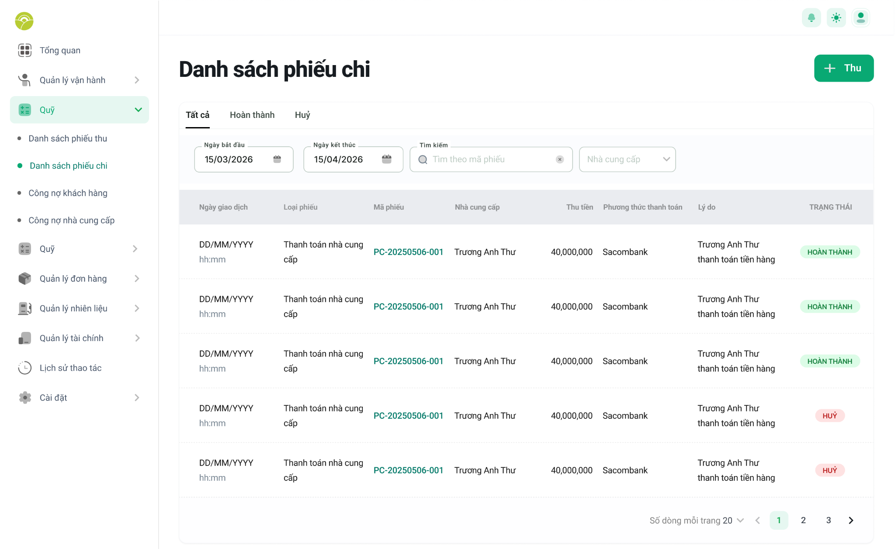
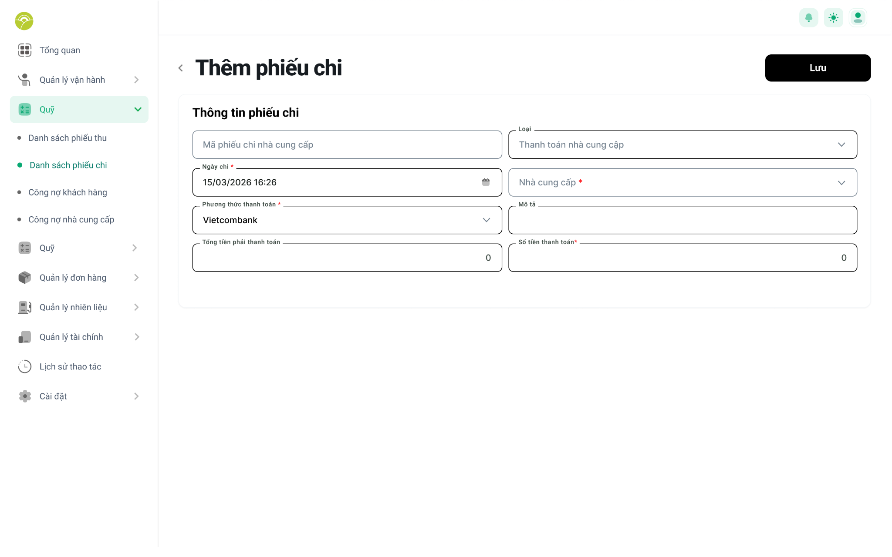
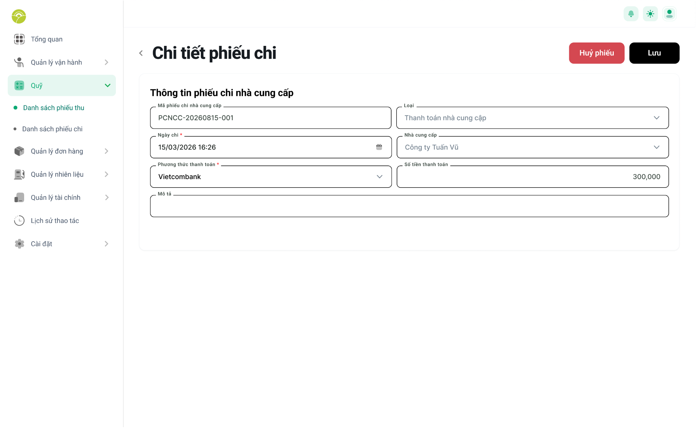

## TÀI LIỆU ĐẶC TẢ YÊU CẦU PHẦN MỀM (SRS)

Tên dự án: TMS – Transportation Management System

Module: Quỹ – Phiếu chi

### Lịch sử thay đổi (Revision History)

| Phiên bản | Ngày | Người thực hiện | Nội dung thay đổi |
|---|---|---|---|
| v1.0 | 20/08/2026 | Thư | Khởi tạo tài liệu |

### 1. GIỚI THIỆU (Introduction)

#### 1.1. Mục đích tài liệu

Tài liệu SRS này đặc tả yêu cầu chức năng cho module Phiếu chi thuộc hệ thống TMS (Transportation Management System). Tài liệu tập trung mô tả chi tiết từng field trên giao diện, quy tắc nghiệp vụ, và luồng xử lý — làm cơ sở cho team Dev (FE/BE), QC và các bên liên quan.

#### 1.2. Phạm vi hệ thống (Scope)

In-scope:

Màn hình Danh sách phiếu chi

Màn hình Thêm mới phiếu chi

Màn hình Chỉnh sửa phiếu chi (xem / chỉnh sửa)

Huỷ phiếu chi

Out-of-scope:

Module Phiếu thu (quản lý riêng)

Báo cáo tài chính tổng hợp

Tích hợp ngân hàng / thanh toán tự động

#### 1.3. Thuật ngữ & viết tắt (Glossary)

| Thuật ngữ | Định nghĩa |
|---|---|
| Phiếu chi (PC) | Chứng từ ghi nhận khoản chi tiền từ quỹ, dùng để thanh toán cho nhà cung cấp đối với các đơn thuê ngoài hoặc các khoản chi phí khác |
| Nhà cung cấp (NCC) | Đối tác cung cấp dịch vụ/hàng hoá mà công ty cần thanh toán |
| Phương thức thanh toán | Kênh thanh toán (tài khoản ngân hàng, tiền mặt...) được sử dụng để chi tiền |
| Tổng cần chi | Tổng số tiền phải thanh toán theo nghĩa vụ (từ đơn thuê ngoài...) |
| Chi tiền | Số tiền thực tế đã chi / sẽ chi trong phiếu này |

### 2. MÔ TẢ TỔNG QUAN (Overall Description)

#### 2.1. Bối cảnh nghiệp vụ

Trong quá trình vận hành hệ thống vận tải, công ty phát sinh các khoản chi như thanh toán nhà cung cấp các đơn thuê vận chuyển. Module Phiếu chi thuộc phân hệ Quỹ cho phép kế toán / quản lý tài chính tạo, theo dõi và quản lý các chứng từ chi tiền một cách có hệ thống, đảm bảo minh bạch và truy vết được.

#### 2.2. Đối tượng người dùng

| Vai trò | Mô tả | Quyền hạn chính |
|---|---|---|
| Admin | Quản trị viên hệ thống | Full quyền: xem, tạo, sửa, huỷ phiếu chi |
| Kế toán | Nhân viên kế toán / tài chính | Xem, tạo, sửa phiếu chi |
| Quản lý | Quản lý vận hành | Xem danh sách phiếu chi |

#### 2.3. Trạng thái phiếu chi

| Trạng thái | Giá trị DB (dự kiến) | Mô tả |
|---|---|---|
| Hoàn thành | completed | Phiếu chi đã được tạo và lưu thành công |
| Đã huỷ | cancelled | Phiếu chi bị huỷ bỏ |

### 3. YÊU CẦU CHỨC NĂNG (Functional Requirements)

#### 3.1. Màn hình: Danh sách phiếu chi

 

##### 3.1.1. Mô tả nghiệp vụ (Business Description)

Màn hình hiển thị danh sách tất cả phiếu chi trong hệ thống, cho phép người dùng tìm kiếm, lọc theo các tiêu chí và truy cập vào chi tiết từng phiếu.

##### 3.1.2. User Story

Là kế toán, tôi muốn xem danh sách tất cả phiếu chi để theo dõi tình hình chi tiêu và quản lý các khoản thanh toán.

##### 3.1.3. Luồng xử lý (User Flow)

Người dùng truy cập menu Quỹ → chọn Danh sách phiếu chi.

Hệ thống hiển thị danh sách phiếu chi, mặc định sắp xếp theo ngày chi giảm dần (mới nhất lên trước).

Người dùng có thể sử dụng bộ lọc để tìm kiếm phiếu chi theo ngày, loại, trạng thái, nhà cung cấp.

Người dùng click vào một dòng trong bảng → hệ thống chuyển sang màn hình Chỉnh sửa phiếu chi.

Luồng ngoại lệ: Nếu không có dữ liệu → hiển thị trạng thái empty state "Không có phiếu chi nào".

##### 3.1.4. Đặc tả giao diện (UI Specification)

Bộ lọc (Filter Bar):

| # | Field | Mô tả chi tiết |
|---|---|---|
| 1 | Tìm kiếm | Placeholder: "Tìm theo mã phiếu, nhà cung cấp...". Tìm kiếm theo mã phiếu chi hoặc tên nhà cung cấp. Trigger search khi nhấn Enter hoặc sau khi ngừng gõ 500ms |
| 2 | Ngày chi | Lọc phiếu chi theo khoảng thời gian. Format: DD/MM/YYYY |
| 3 | Loại | Lọc theo loại phiếu chi. Các giá trị: Tất cả, Thanh toán nhà cung cấp, và các loại khác (nếu có). Source: bảng enum loại phiếu chi |
| 4 | Trạng thái | Lọc theo trạng thái phiếu. Các giá trị: Tất cả, Hoàn thành, Đã huỷ |

Bảng danh sách (Table):

| # | Tên cột | Mô tả chi tiết |
|---|---|---|
| 1 | Mã phiếu chi | Format: PC-YYYYMMDD-XXX. Click → navigate đến Chỉnh sửa phiếu chi |
| 2 | Ngày chi | Ngày thực hiện chi tiền |
| 3 | Loại | Hiển thị loại phiếu chi (VD: "Thanh toán nhà cung cấp") |
| 4 | Nhà cung cấp | Tên nhà cung cấp liên kết với phiếu chi |
| 5 | Tổng cần chi | Tổng số tiền cần chi |
| 6 | Chi tiền | Số tiền thực tế đã chi |
| 7 | Phương thức thanh toán | Tên phương thức / tài khoản ngân hàng |
| 8 | Trạng thái | Enum mapping:  completed → "Hoàn thành"  cancelled → "Đã huỷ" |

Nút hành động:

| Nút | Mô tả |
|---|---|
| Tạo phiếu chi | Button primary. Click → navigate đến màn hình Thêm mới phiếu chi |

##### 3.1.5. Quy tắc nghiệp vụ (Business Rules)

| Mã | Quy tắc |
|---|---|
| BR-PC-001 | Danh sách mặc định sắp xếp theo ngày chi giảm dần (mới nhất lên trước) |
| BR-PC-002 | Phân trang mặc định 20 dòng/trang. Hỗ trợ chuyển trang và thay đổi số dòng/trang |
| BR-PC-003 | Bộ lọc áp dụng ngay khi thay đổi giá trị (không cần nút "Tìm kiếm") |

#### 3.2. Màn hình: Thêm mới phiếu chi

 

##### 3.2.1. Mô tả nghiệp vụ (Business Description)

Màn hình cho phép người dùng (kế toán / admin) tạo mới một phiếu chi để ghi nhận khoản thanh toán cho nhà cung cấp. Người dùng nhập thông tin phiếu chi bao gồm ngày chi, loại, nhà cung cấp, phương thức thanh toán, số tiền và ghi chú. Sau khi lưu thành công, hệ thống tự sinh mã phiếu chi và chuyển phiếu sang trạng thái "Hoàn thành".

##### 3.2.2. User Story

Là kế toán, tôi muốn tạo mới phiếu chi để ghi nhận khoản thanh toán cho nhà cung cấp dịch vụ vận chuyển.

##### 3.2.3. Luồng xử lý (User Flow)

Luồng chính — Tạo mới phiếu chi:

Từ màn hình Danh sách phiếu chi, người dùng click nút "Tạo phiếu chi".

Hệ thống mở màn hình Thêm mới phiếu chi với tiêu đề "Thêm phiếu chi". Tất cả các field ở trạng thái trống (hoặc giá trị mặc định).

Người dùng nhập thông tin vào form:

Chọn Ngày chi (mặc định ngày hiện tại).

Chọn Loại phiếu chi.

Chọn Nhà cung cấp từ dropdown searchable → hệ thống tự động tính Tổng cần chi dựa trên các chỉ thị giao hàng có loại phương tiện ngoài đã hoàn thành tương ứng với đơn thuê vận chuyển của nhà cung cấp đó.

Chọn Phương thức thanh toán.

Nhập Chi tiền (số tiền thực chi).

Nhập Ghi chú (không bắt buộc).

Người dùng nhấn nút Lưu.

Hệ thống validate dữ liệu → nếu hợp lệ:

Tự sinh mã phiếu chi theo format PC-YYYYMMDD-XXX.

Lưu phiếu với trạng thái "Hoàn thành".

Hiển thị toast thông báo "Tạo phiếu chi thành công".

Chuyển về màn hình Danh sách phiếu chi.

Luồng ngoại lệ:

Nếu validate thất bại → hệ thống highlight trường lỗi và hiển thị message lỗi tương ứng bên dưới field.

Nếu người dùng nhấn nút quay lại (←) khi đang có dữ liệu đã nhập → hiển thị popup confirm "Bạn có thay đổi chưa lưu. Bạn có muốn rời trang không?".

##### 3.2.4. Đặc tả giao diện (UI Specification)

Form thông tin phiếu chi (Tạo mới):

Nút hành động:

| Nút | Vị trí | Mô tả |
|---|---|---|
| Lưu | Góc trên phải | Click → validate tất cả field bắt buộc → gọi API tạo phiếu chi: thành công → hiển thị toast "Tạo phiếu chi thành công" → navigate về Danh sách phiếu chi;  thất bại → hiển thị toast lỗi |
| Nút quay lại (←) | Bên trái tiêu đề "Thêm phiếu chi" | Click → navigate về Danh sách phiếu chi. Nếu có dữ liệu đã nhập → hiển thị popup confirm "Bạn có thay đổi chưa lưu. Bạn có muốn rời trang không?" |

##### 3.2.5. Quy tắc nghiệp vụ (Business Rules)

| Mã | Quy tắc |
|---|---|
| BR-PC-010 | Mã phiếu chi được hệ thống tự sinh khi lưu, theo format: PC-YYYYMMDD-XXX (VD: PC-20260417-001), trong đó YYYYMMDD là ngày tạo phiếu, XXX là số thứ tự tăng dần trong ngày |
| BR-PC-011 | Khi tạo mới, field "Ngày chi" mặc định là ngày hiện tại, "Chi tiền" mặc định bằng 0, "Trạng thái" mặc định là "Hoàn thành" |
| BR-PC-012 | Khi chọn Nhà cung cấp, hệ thống tự động tính "Tổng cần chi" = tổng thành tiền của các chỉ thị giao hàng có loại phương tiện ngoài đã hoàn thành thuộc đơn thuê vận chuyển tương ứng với nhà cung cấp đã chọn |
| BR-PC-013 | "Chi tiền" phải lớn hơn 0 |
| BR-PC-014 | "Chi tiền" không được vượt quá "Tổng cần chi" |
| BR-PC-015 | Tất cả các field đánh dấu (*) phải được nhập / chọn trước khi lưu |

Validation Errors:

| Error Code | Trường liên quan | Message hiển thị |
|---|---|---|
| VAL-PC-001 | Ngày chi | "Vui lòng chọn ngày chi" |
| VAL-PC-002 | Loại | "Vui lòng chọn loại phiếu chi" |
| VAL-PC-003 | Nhà cung cấp | "Vui lòng chọn nhà cung cấp" |
| VAL-PC-004 | Phương thức thanh toán | "Vui lòng chọn phương thức thanh toán" |
| VAL-PC-005 | Chi tiền | "Chi tiền phải lớn hơn 0" |
| VAL-PC-006 | Chi tiền | "Chi tiền không được vượt quá Tổng cần chi" |
| VAL-PC-007 | Ghi chú | "Ghi chú không được vượt quá 500 ký tự" |

#### 3.3. Màn hình: Chỉnh sửa phiếu chi

 

##### 3.3.1. Mô tả nghiệp vụ (Business Description)

Màn hình cho phép người dùng xem chi tiết thông tin một phiếu chi đã tạo, chỉnh sửa các trường được phép tuỳ theo trạng thái phiếu, và thực hiện hành động huỷ phiếu. Đây là màn hình dùng chung cho cả mục đích "Xem chi tiết" và "Chỉnh sửa" — hệ thống tự điều chỉnh trạng thái editable/readonly của các field dựa trên trạng thái hiện tại của phiếu chi.

##### 3.3.2. User Story

Là kế toán, tôi muốn xem và chỉnh sửa thông tin phiếu chi đã tạo để cập nhật phương thức thanh toán, ghi chú hoặc huỷ phiếu khi cần.

##### 3.3.3. Luồng xử lý (User Flow)

Luồng chính — Xem & chỉnh sửa phiếu chi:

Từ Danh sách phiếu chi, người dùng click vào mã phiếu chi hoặc dòng trong bảng.

Hệ thống hiển thị màn hình Chỉnh sửa phiếu chi với tiêu đề "Chi tiết phiếu chi" kèm mã phiếu (VD: #PC-20260417-001).

Hệ thống load dữ liệu phiếu chi và hiển thị vào form. Các field editable/readonly tuỳ theo trạng thái phiếu (xem BR-PC-020, BR-PC-021).

Người dùng chỉnh sửa các trường cho phép.

Người dùng nhấn Lưu → hệ thống validate dữ liệu → lưu thành công → hiển thị thông báo "Lưu phiếu chi thành công".

Luồng phụ — Huỷ phiếu:

Người dùng nhấn nút Huỷ phiếu (màu đỏ). Nút này chỉ hiển thị khi phiếu ở trạng thái "Hoàn thành".

Hệ thống hiển thị popup xác nhận: "Bạn có chắc chắn muốn huỷ phiếu chi này không?".

Người dùng nhấn Xác nhận → hệ thống chuyển trạng thái phiếu sang "Đã huỷ", ghi nhận thời gian huỷ và người thực hiện huỷ → tất cả các trường trở thành read-only, ẩn nút "Huỷ phiếu" và "Lưu".

Người dùng nhấn Huỷ bỏ trên popup → đóng popup, không thay đổi gì.

Luồng ngoại lệ:

Nếu validate thất bại → hệ thống highlight trường lỗi và hiển thị message lỗi tương ứng bên dưới field.

Nếu phiếu đang ở trạng thái "Đã huỷ" → tất cả các trường read-only, ẩn nút "Huỷ phiếu" và "Lưu".

Nếu người dùng nhấn nút quay lại (←) khi có thay đổi chưa lưu → hiển thị popup confirm "Bạn có thay đổi chưa lưu. Bạn có muốn rời trang không?".

##### 3.3.4. Đặc tả giao diện (UI Specification)

Form thông tin phiếu chi (Chỉnh sửa):

| # | Field | Loại component | Bắt buộc | Format hiển thị | Mô tả chi tiết |
|---|---|---|---|---|---|
| 1 | Mã phiếu chi nhà cung cấp | Label (readonly) | — | Text | Luôn readonly. Hiển thị mã phiếu đã sinh (VD: PCNCC-20260815-001) |
| 2 | Loại |  | — | Text | Readonly.  Mapping: supplier_payment |
| 3 | Ngày chi | Date-time picker | Có (*) | DD/MM/YYYY HH:mm | Trạng thái "Hoàn thành": Date-time picker, cho phép chỉnh sửa.  Trạng thái "Huỷ": Label readonly |
| 4 | Nhà cung cấp | Dropdown | Có (*) | Text | Trạng thái "Hoàn thành": Dropdown searchable, cho phép đổi NCC.  Trạng thái "Huỷ": Label readonly.  Hiển thị tên nhà cung cấp |
| 5 | Phương thức thanh toán | Dropdown | Có (*) | Text | Trạng thái "Hoàn thành": Dropdown, cho phép đổi.  Trạng thái "Huỷ": Label readonly |
| 6 | Số tiền thanh toán | Number input | Có (*) | Số có dấu phân cách nghìn | Trạng thái "Hoàn thành": Number input hiển thị số tiền thanh toán đã tạo trước đó của phiếu chi, cho phép sửa. Trạng thái "Huỷ": Label readonly |
| 7 | Mô tả | Textarea | Không | Text | Trạng thái "Hoàn thành": Textarea, cho phép sửa.  Trạng thái "Huỷ": Label readonly |

Nút hành động:

| Nút | Điều kiện hiển thị | Mô tả |
|---|---|---|
| Lưu | Chỉ hiển thị khi trạng thái = "Hoàn thành" | Click → validate các field editable bắt buộc → gọi API cập nhật phiếu chi: thành công → hiển thị toast "Lưu phiếu chi thành công"; thất bại → hiển thị toast lỗi |
| Huỷ phiếu | Chỉ hiển thị khi trạng thái = "Hoàn thành" | Button màu đỏ. Click → hiển thị popup xác nhận huỷ → xác nhận → chuyển trạng thái sang "Đã huỷ", ghi nhận cancelled_by và cancelled_at |
| Nút quay lại (←) | Luôn hiển thị | Click → navigate về Danh sách phiếu chi. Nếu có thay đổi chưa lưu → hiển thị popup confirm "Bạn có thay đổi chưa lưu. Bạn có muốn rời trang không?" |

##### 3.3.5. Quy tắc nghiệp vụ (Business Rules)

| Mã | Quy tắc |
|---|---|
| BR-PC-020 | Phiếu chi ở trạng thái "Hoàn thành" → chỉ cho phép chỉnh sửa 3 field: Phương thức thanh toán, Chi tiền, Ghi chú. Các field còn lại read-only |
| BR-PC-021 | Phiếu chi ở trạng thái "Đã huỷ" → tất cả các field chuyển sang read-only, ẩn nút "Huỷ phiếu" và "Lưu" |
| BR-PC-022 | "Chi tiền" phải lớn hơn 0 |
| BR-PC-023 | "Chi tiền" không được vượt quá "Tổng cần chi" |
| BR-PC-024 | Khi huỷ phiếu, hệ thống ghi nhận thời gian huỷ (cancelled_at) và người thực hiện huỷ (cancelled_by) |
| BR-PC-025 | Phiếu chi đã huỷ không thể khôi phục lại trạng thái "Hoàn thành" |
| BR-PC-026 | Field "Phương thức thanh toán" bắt buộc — không cho phép lưu nếu chưa chọn (khi đang ở trạng thái editable) |

Validation Errors:

| Error Code | Trường liên quan | Message hiển thị |
|---|---|---|
| VAL-PC-010 | Phương thức thanh toán | "Vui lòng chọn phương thức thanh toán" |
| VAL-PC-011 | Chi tiền | "Chi tiền phải lớn hơn 0" |
| VAL-PC-012 | Chi tiền | "Chi tiền không được vượt quá Tổng cần chi" |
| VAL-PC-013 | Ghi chú | "Ghi chú không được vượt quá 500 ký tự" |

### 4. YÊU CẦU DỮ LIỆU (Data Requirements)

#### 4.1. Mô hình dữ liệu (Data Model)

#### 4.2. Từ điển dữ liệu (Data Dictionary)

Lưu ý: Bảng payment_vouchers chưa tồn tại trong DB staging hiện tại — cấu trúc bên dưới là dự kiến dựa trên yêu cầu giao diện, cần xác nhận lại với BE. Bảng payment_method đã tồn tại trong DB.

Bảng: payment_vouchers (dự kiến — cần tạo mới)

| Trường | Kiểu dữ liệu | Bắt buộc | Mô tả |
|---|---|---|---|
| id | varchar (PK) | Có | UUID, khóa chính |
| tenant_id | varchar | Có | ID tenant (multi-tenancy) |
| code | varchar | Có | Mã phiếu chi tự sinh, format: PCNCC-YYYYMMDD-XXX |
| search_code | varchar | Có | Mã phiếu chi viết thường, dùng cho tìm kiếm |
| type | varchar | Có | Loại phiếu chi. Enum: supplier_payment = Thanh toán nhà cung cấp |
| date | timestamp with time zone | Có | Ngày giờ chi tiền |
| supplier_id | varchar (FK) | Có |  |
| payment_method_id | varchar (FK) | Có | payment_method.id |
| amount | numeric | Có | Số tiền thanh toán |
| total_payable | numeric | Không | Tổng tiền phải thanh toán (snapshot tại thời điểm tạo) |
| description | varchar | Không | Mô tả / lý do chi |
| status | varchar | Có | Trạng thái phiếu chi. Enum: completed = Hoàn thành, cancelled = Huỷ |
| is_deleted | boolean | Có | Soft delete. Default: false |
| created_at | timestamp with time zone | Có | Thời điểm tạo |
| created_by | varchar | Không | ID user tạo |
| modified_at | timestamp with time zone | Có | Thời điểm cập nhật cuối |
| modified_by | varchar | Không | ID user cập nhật cuối |

Bảng: payment_method (đã tồn tại trong DB)

| Trường | Kiểu dữ liệu | Bắt buộc | Mô tả |
|---|---|---|---|
| id | varchar (PK) | Có | UUID, khóa chính |
| tenant_id | varchar | Có | ID tenant |
| name | varchar | Có | Tên phương thức thanh toán |
| search_name | varchar | Có | Tên dùng cho tìm kiếm (normalized) |
| type | varchar | Có | Loại phương thức (VD: bank_transfer, cash) |
| is_active | boolean | Có | Trạng thái hoạt động (default: true) |
| is_deleted | boolean | Có | Đánh dấu xoá mềm (default: false) |
| bank_id | varchar | Không | FK → banks.id (nullable, chỉ áp dụng cho phương thức ngân hàng) |
| account_no | varchar | Không | Số tài khoản ngân hàng |
| account_name | varchar | Không | Tên chủ tài khoản |
| created_at | timestamp | Có | Thời gian tạo |
| created_by | varchar | Không | Người tạo |
| modified_at | timestamp | Có | Thời gian cập nhật |
| modified_by | varchar | Không | Người cập nhật |