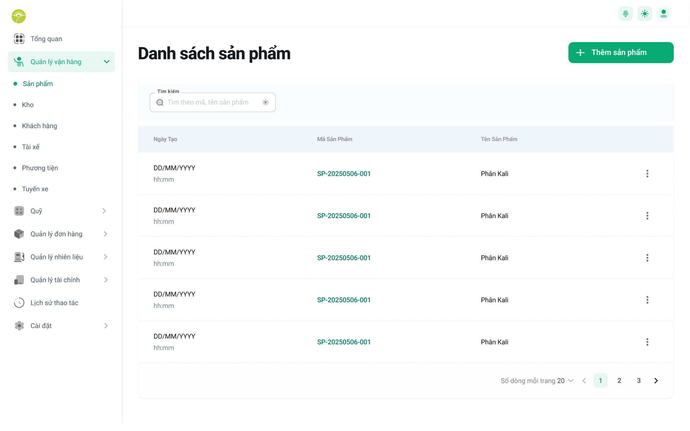
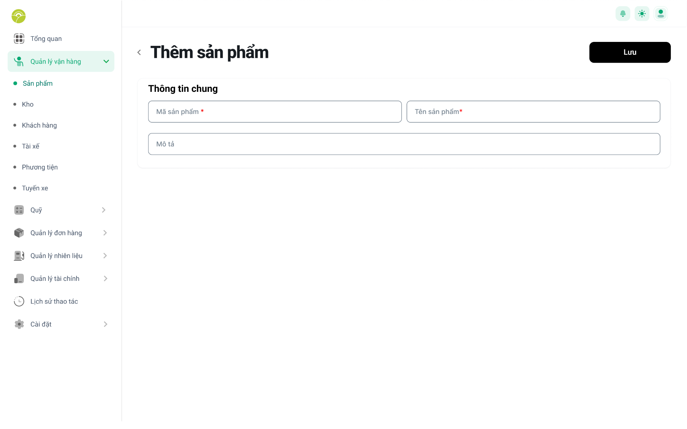
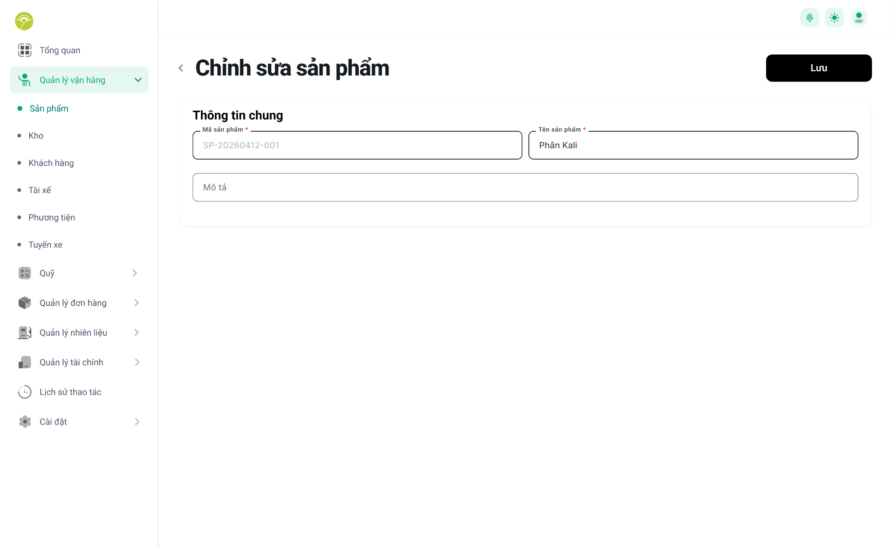

## TÀI LIỆU ĐẶC TẢ YÊU CẦU PHẦN MỀM (SRS)

Tên dự án: TMS – Transportation Management System

Module: Quản lý sản phẩm

### Lịch sử thay đổi (Revision History)

| Phiên bản | Ngày | Người thực hiện | Nội dung thay đổi |
|---|---|---|---|
| v1.0 | 18/07/2026 | Thư | Khởi tạo tài liệu |

### 1. GIỚI THIỆU (Introduction)

#### 1.1. Mục đích tài liệu

Tài liệu SRS này đặc tả yêu cầu chức năng và phi chức năng cho module Quản lý sản phẩm thuộc hệ thống TMS (Transportation Management System). Tài liệu là cơ sở cho team Dev (FE/BE), QC và các bên liên quan trong quá trình phát triển, kiểm thử và nghiệm thu.

#### 1.2. Phạm vi hệ thống (Scope)

In-scope:

Màn hình Danh sách sản phẩm (Product List)

Màn hình Thêm sản phẩm (Create Product)

Màn hình Chỉnh sửa sản phẩm (Edit Product)

Tìm kiếm, lọc sản phẩm theo mã và tên

Sắp xếp danh sách theo cột

Out-of-scope:

Quản lý danh mục sản phẩm (Product Category)

Import/Export sản phẩm hàng loạt

Quản lý đơn vị tính (Unit of Measure)

Tích hợp đồng bộ sản phẩm từ hệ thống bên ngoài (SAP/ERP)

#### 1.3. Tài liệu tham chiếu

| Tài liệu | Link / Vị trí | Ghi chú |
|---|---|---|
| Figma Design | [link] | Màn hình Danh sách & Thêm sản phẩm |

### 2. MÔ TẢ TỔNG QUAN (Overall Description)

#### 2.1. Bối cảnh & vấn đề (Business Context)

Trong hệ thống TMS, sản phẩm là dữ liệu danh mục (master data) đại diện cho các loại phân bón được vận chuyển. Sản phẩm được tham chiếu trong các đơn hàng giao hàng (Delivery Order) tại mục chi tiết hàng hoá. Người dùng cần có khả năng quản lý danh mục sản phẩm: xem danh sách, thêm mới, chỉnh sửa thông tin, và tìm kiếm nhanh theo mã hoặc tên sản phẩm.

#### 2.2. Đối tượng người dùng (User Personas)

| Vai trò (Role) | Mô tả | Quyền hạn chính |
|---|---|---|
| Admin | Quản trị viên hệ thống TMS | Full quyền: xem, thêm, sửa, xoá sản phẩm |
| Nhân viên vận hành | Người dùng nghiệp vụ vận tải | Xem danh sách, thêm mới, chỉnh sửa sản phẩm |

### 3. YÊU CẦU CHỨC NĂNG (Functional Requirements)

#### 3.1. Màn hình: Danh sách sản phẩm (Product List)

##### 3.1.1. Mô tả nghiệp vụ (Business Description)

Màn hình hiển thị danh sách toàn bộ sản phẩm trong hệ thống dưới dạng bảng. Người dùng có thể tìm kiếm theo mã hoặc tên sản phẩm, sắp xếp theo từng cột, và truy cập nhanh vào trang thêm mới sản phẩm.

Đường dẫn truy cập: Sidebar → Vận Hành → [Submenu] → Danh sách sản phẩm

 

##### 3.1.2. User Story

Là nhân viên vận hành, tôi muốn xem danh sách tất cả sản phẩm và tìm kiếm nhanh theo mã hoặc tên để tra cứu thông tin sản phẩm khi cần.

##### 3.1.3. Luồng xử lý (User Flow)

##### 3.1.4. Đặc tả giao diện (UI Specification)

Thanh tìm kiếm (Search bar):

| # | Thành phần (Component) | Loại | Bắt buộc | Mô tả / Validation |
|---|---|---|---|---|
| 1 | Tìm theo mã và tên sản phẩm | Search Input | Không | Placeholder: "Tìm theo mã và tên sản phẩm".  Có icon search bên trái, icon clear (x) khi có nội dung.  Tìm kiếm trên cả mã và tên sản phẩm. |

Bảng danh sách (Data Table):

| # | Cột (Column) | Kiểu hiển thị | Sắp xếp | Mô tả |
|---|---|---|---|---|
| 1 | Ngày tạo | Text (DD/MM/YYYY HH:mm) | Có (↑↓) | Hiển thị created_at, format: DD/MM/YYYY và dòng dưới hiển thị giờ HH:mm. Mặc định sắp xếp DESC. |
| 2 | Mã sản phẩm | Text (link style, màu xanh) | Có (↑↓) | Hiển thị code. Click vào mã → mở màn hình chi tiết/chỉnh sửa sản phẩm. |
| 3 | Tên sản phẩm | Text | Có (↑↓) | Hiển thị name. |

Phân trang (Pagination):

| # | Thành phần | Mô tả |
|---|---|---|
| 1 | Phân trang | Mặc định hiển thị 20 bản ghi/trang. Có nút Previous / Next và chọn số trang. |

Nút hành động (Action Buttons):

| # | Nút | Vị trí | Mô tả |
|---|---|---|---|
| 1 | + Thêm Sản Phẩm | Góc trên bên phải (header) | Button primary, nền xanh lá, chữ trắng. Click → chuyển sang màn hình Thêm sản phẩm. |

##### 3.1.5. Quy tắc nghiệp vụ (Business Rules)

| Mã | Quy tắc |
|---|---|
| BR-PRD-001 | Danh sách chỉ hiển thị sản phẩm có is_deleted = false thuộc tenant hiện tại. |
| BR-PRD-002 | Sắp xếp mặc định: created_at DESC (mới nhất lên trước). |
| BR-PRD-003 | Tìm kiếm không phân biệt hoa/thường (case-insensitive), tìm trên cả search_code và search_name. |
| BR-PRD-004 | Mã sản phẩm trong bảng hiển thị dạng link — click để mở chi tiết sản phẩm. |

##### 3.1.6. Đặc tả API (dành cho BE)

| # | Endpoint | Method | Mô tả |
|---|---|---|---|
| 1 | /api/v1/products/list | POST | Lấy danh sách sản phẩm, hỗ trợ search, sort, paging |

Query Params:

| Trường | Kiểu | Bắt buộc | Mô tả |
|---|---|---|---|
| pageIndex | integer | Có | Trang hiện tại (bắt đầu từ 1). Default: 1 |
| pageSize | integer | Có | Số bản ghi mỗi trang. Default: 20 |
| startDate | string (ISO 8601) \| null | Không | Lọc theo ngày tạo — từ ngày. Format: yyyy-MM-ddTHH:mm:ss.SSSZ. Null = không lọc |
| endDate | string (ISO 8601) \| null | Không | Lọc theo ngày tạo — đến ngày. Format: yyyy-MM-ddTHH:mm:ss.SSSZ. Null = không lọc |
| isCount | boolean | Có | true = response trả kèm tổng số bản ghi (phục vụ phân trang). Default: true |
| isAll | boolean | Có | true = lấy toàn bộ bản ghi (bỏ qua phân trang).  Default: false |
| searchText | string | Không | Từ khoá tìm kiếm, match trên search_code và search_name (case-insensitive).  Rỗng = không lọc |
| sort | object | Không | Object chứa thông tin sắp xếp |
| sort.sortDirection | string | Không | Chiều sắp xếp: ASC, DESC, hoặc None.  Default: DESC |
| sort.sortPropertyName | string | Không | Tên cột sắp xếp: createdAt, code, name.  Default: createdAt |

Chi tiết Response Body:

| Trường | Kiểu | Mô tả |
|---|---|---|
| id | string (UUID) | ID sản phẩm |
| code | string | Mã sản phẩm |
| name | string | Tên sản phẩm |
| description | string \| null | Mô tả sản phẩm |
| isActive | boolean | Trạng thái hoạt động |
| createdAt | string (ISO 8601) | Thời điểm tạo.  FE format hiển thị: DD/MM/YYYY HH:mm |
| totalCount | integer | Tổng số bản ghi (chỉ trả khi isCount = true) |

#### 3.2. Màn hình: Thêm sản phẩm (Create Product)

##### 3.2.1. Mô tả nghiệp vụ (Business Description)

Màn hình cho phép người dùng thêm mới một sản phẩm vào hệ thống. Form gồm các trường: mã sản phẩm (bắt buộc), tên sản phẩm (bắt buộc), và mô tả (tuỳ chọn). Sau khi lưu thành công, sản phẩm xuất hiện trong danh sách.

Đường dẫn: Danh sách sản phẩm → Nút "+ Thêm Sản Phẩm" → Màn hình Thêm sản phẩm

 

##### 3.2.2. User Story

Là nhân viên vận hành, tôi muốn thêm mới sản phẩm với mã, tên và mô tả để bổ sung sản phẩm vào danh mục hệ thống phục vụ tạo đơn hàng vận chuyển.

##### 3.2.3. Luồng xử lý (User Flow)

##### 3.2.4. Đặc tả giao diện (UI Specification)

Form nhập liệu — Section "Thông tin chung":

| # | Thành phần (Component) | Loại | Bắt buộc | Mô tả / Validation |
|---|---|---|---|---|
| 1 | Mã sản phẩm | Textbox | Có (*) | Placeholder: "Mã sản phẩm". Không giới hạn ký tự (varchar).  Không cho phép trùng mã trong cùng tenant.  Giá trị được lưu vào cả code |
| 2 | Tên sản phẩm | Textbox | Có (*) | Placeholder: "Tên sản phẩm".  Không giới hạn ký tự (varchar).  Giá trị được lưu vào cả name |
| 3 | Mô tả | Textarea | Không | Placeholder: "Mô tả". Multi-line, chiều cao tự co giãn.  Cho phép để trống. |

##### 3.2.5. Quy tắc nghiệp vụ (Business Rules)

| Mã | Quy tắc |
|---|---|
| BR-PRD-005 | Mã sản phẩm (code) là duy nhất Kiểm tra trùng lặp trước khi lưu. |
| BR-PRD-006 | Khi tạo sản phẩm, hệ thống tự động set is_active = true, is_deleted = false. |
| BR-PRD-007 | Trường search_code và search_name được tạo tự động từ code và name (chuyển lowercase / bỏ dấu) để phục vụ tìm kiếm. |
| BR-PRD-008 | Trường tenant_id được gán tự động từ session của người dùng đang đăng nhập. |
| BR-PRD-009 | Trường id được sinh tự động (UUID). |
| BR-PRD-010 | Trường created_at, created_by, modified_at, modified_by được ghi tự động bởi hệ thống. |
| BR-PRD-011 | Nút "Lưu" chỉ enable khi cả Mã sản phẩm và Tên sản phẩm đã được nhập. |

Validation Errors:

| Mã lỗi | Trường | Điều kiện | Message hiển thị |
|---|---|---|---|
| VE-PRD-002 | Tên sản phẩm | Để trống | "Vui lòng nhập tên sản phẩm" |
| VE-PRD-003 | Mã sản phẩm | Trùng mã đã tồn tại | "Mã sản phẩm đã tồn tại" |

##### 3.2.6. Đặc tả API (dành cho BE)

| # | Endpoint | Method | Mô tả |
|---|---|---|---|
| 1 | /api/v1/products | POST | Tạo mới sản phẩm |

Error Codes:

| Error Code | Message | Trường hợp |
|---|---|---|
| ERR_VALIDATION | Dữ liệu không hợp lệ | Thiếu trường bắt buộc (code, name) |
| product.save.code_duplicate | Mã sản phẩm đã tồn tại | code trùng với sản phẩm khác trong cùng tenant |

Lưu ý cho BE:

Khi lưu, tự động generate search_code từ code (lowercase, bỏ dấu) và search_name từ name (lowercase, bỏ dấu) để phục vụ tìm kiếm nhanh.

id sinh tự động (UUID v4).

tenant_id lấy từ context authentication của user.

created_at = modified_at = thời điểm tạo; created_by = modified_by = user ID hiện tại.

#### 3.3. Màn hình: Chỉnh sửa sản phẩm (Edit Product)

##### 3.3.1. Mô tả nghiệp vụ (Business Description)

Màn hình cho phép người dùng chỉnh sửa thông tin sản phẩm đã tồn tại. Giao diện giống màn hình Thêm sản phẩm nhưng các trường được pre-fill dữ liệu hiện tại. Người dùng truy cập bằng cách click vào mã sản phẩm từ danh sách.

 

##### 3.3.2. User Story

Là nhân viên vận hành, tôi muốn chỉnh sửa tên hoặc mô tả sản phẩm để cập nhật thông tin chính xác khi có thay đổi.

##### 3.3.3. Luồng xử lý (User Flow)

##### 3.3.4. Đặc tả giao diện (UI Specification)

Giao diện giống hệt màn hình Thêm sản phẩm (mục 3.2.4) với các khác biệt:

| # | Khác biệt | Mô tả |
|---|---|---|
| 1 | Tiêu đề header | "Chỉnh sửa sản phẩm" (thay vì "Thêm sản phẩm") |
| 2 | Dữ liệu form | Pre-fill từ dữ liệu sản phẩm hiện tại |
| 3 | Mã sản phẩm | Không được chỉnh sửa |

##### 3.3.5. Quy tắc nghiệp vụ (Business Rules)

| Mã | Quy tắc |
|---|---|
| BR-PRD-013 | Khi cập nhật, hệ thống tự động cập nhật modified_at và modified_by. |
| BR-PRD-014 | Nếu thay đổi name, phải cập nhật lại search_name tương ứng. |

##### 3.3.6. Đặc tả API (dành cho BE)

| # | Endpoint | Method | Mô tả |
|---|---|---|---|
| 1 | /api/v1/products/{id} | GET | Lấy chi tiết sản phẩm theo ID |

### 4. YÊU CẦU DỮ LIỆU (Data Requirements)

Bảng: product

| Trường (Field) | Kiểu dữ liệu | Bắt buộc | Default | Mô tả |
|---|---|---|---|---|
| id | varchar (PK) | Có | — | UUID định danh sản phẩm, sinh tự động |
| tenant_id | varchar | Có | — | ID tenant, gán tự động từ session user |
| code | varchar | Có | — | Mã sản phẩm, do người dùng nhập. Unique per tenant. |
| name | varchar | Có | — | Tên sản phẩm |
| description | varchar | Không | NULL | Mô tả sản phẩm |
| is_active | boolean | Có | true | Trạng thái hoạt động |
| is_deleted | boolean | Có | false | Soft delete flag. true = đã xoá (ẩn khỏi danh sách). |
| search_code | varchar | Có | — | Mã sản phẩm dạng chuẩn hoá (lowercase, bỏ dấu) để tìm kiếm |
| search_name | varchar | Có | — | Tên sản phẩm dạng chuẩn hoá (lowercase, bỏ dấu) để tìm kiếm |
| created_at | timestamptz | Có | — | Thời điểm tạo bản ghi |
| created_by | varchar | Không | NULL | ID user tạo bản ghi |
| modified_at | timestamptz | Có | — | Thời điểm cập nhật gần nhất |
| modified_by | varchar | Không | NULL | ID user cập nhật gần nhất |

### 5. YÊU CẦU PHI CHỨC NĂNG (Non-Functional Requirements)

| Mã | Nhóm | Yêu cầu | Tiêu chí đo lường |
|---|---|---|---|
| NFR-001 | Performance | Thời gian load danh sách sản phẩm | ≤ 2 giây với 95% request (bao gồm paging, ~357 records) |
| NFR-002 | Performance | Response time API tìm kiếm | ≤ 500ms (P95) |
| NFR-003 | Security | Xác thực & phân quyền | JWT token, phân quyền theo role. Chỉ xem dữ liệu thuộc tenant mình. |
| NFR-004 | Security | Multi-tenancy | Đảm bảo data isolation giữa các tenant |
| NFR-005 | Usability | Responsive | Hỗ trợ desktop (≥ 1280px). Tablet/mobile: không bắt buộc. |
| NFR-006 | Compatibility | Trình duyệt | Chrome, Edge (2 phiên bản gần nhất) |
| NFR-007 | Audit | Logging | Ghi log hành động Create / Update sản phẩm (created_by, modified_by, timestamp) |
| NFR-008 | Localization | Ngôn ngữ | Tiếng Việt |