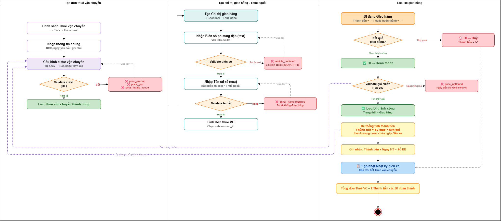
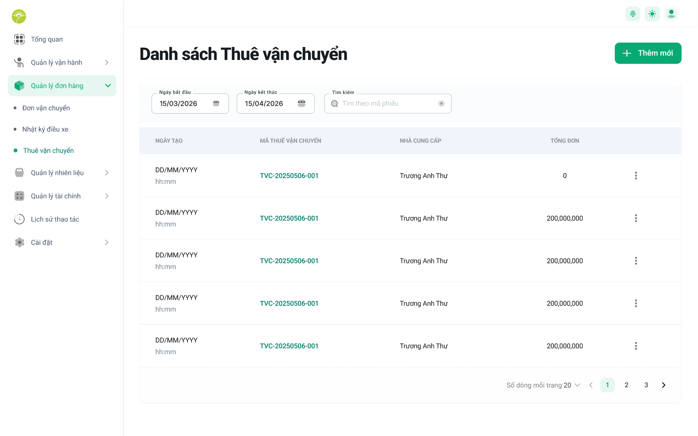
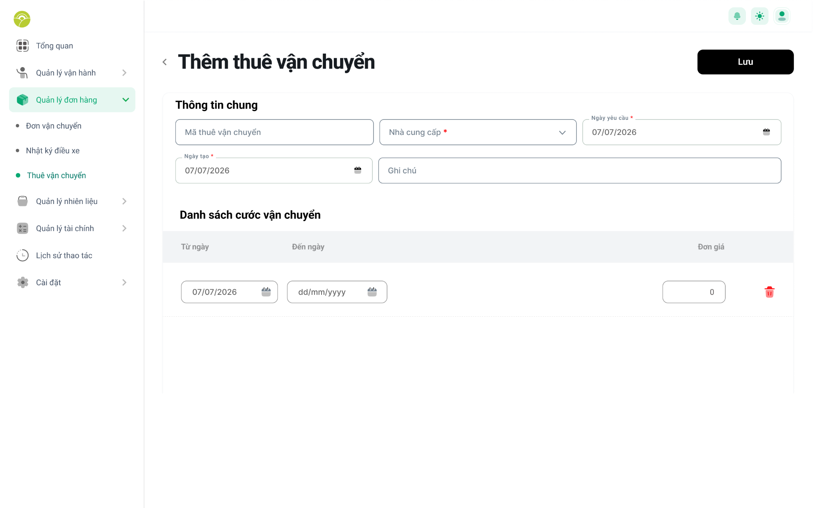
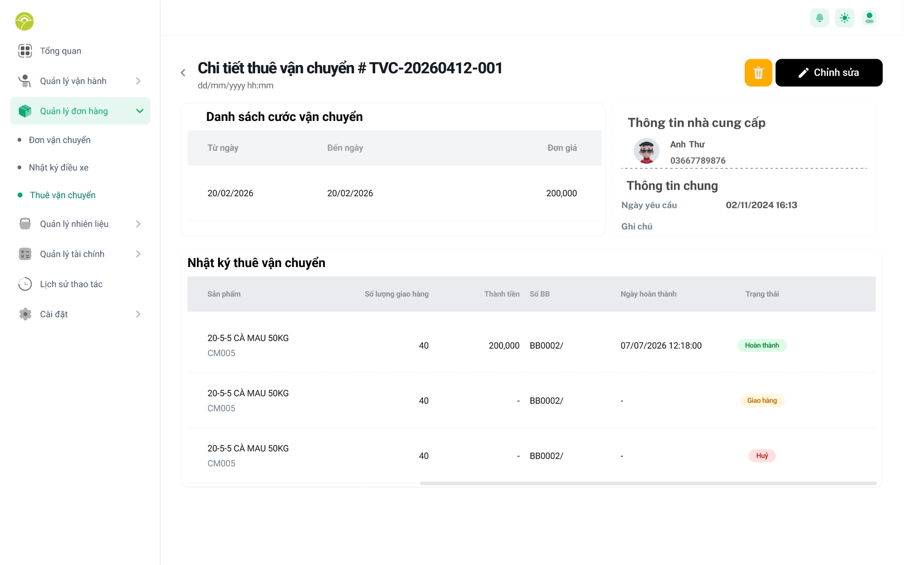

## TÀI LIỆU ĐẶC TẢ YÊU CẦU PHẦN MỀM (SRS)

Tên dự án: TMS – Transportation Management System

Module: Thuê vận chuyển (Subcontract)

### Lịch sử thay đổi (Revision History)

| Phiên bản | Ngày | Người thực hiện | Nội dung thay đổi |
|---|---|---|---|
| v1.0 | 13/07/2026 | Trương Anh Thư | Khởi tạo tài liệu – Redesign Thuê vận chuyển v2 |

### 1. GIỚI THIỆU

### 1.1. Mục đích tài liệu

Tài liệu SRS này đặc tả yêu cầu chức năng và phi chức năng cho việc điều chỉnh lại module Thuê vận chuyển (Subcontract) trên hệ thống TMS Web Manager theo thiết kế mới (v2). Tài liệu làm cơ sở cho team Dev (FE/BE), QC và các bên liên quan trong quá trình phát triển, kiểm thử và nghiệm thu.

#### 1.2. Phạm vi hệ thống (Scope)

In-scope:

Màn hình Danh sách thuê vận chuyển

Màn hình Thêm mới thuê vận chuyển

Màn hình Chi tiết thuê vận chuyển

Màn hình Chỉnh sửa thuê vận chuyển

Danh sách cước vận chuyển theo thời gian (price timeline)

Nhật ký điều xe (Delivery Instruction log) trên chi tiết đơn thuê

Logic tính giá cước khi tạo chỉ thị giao hàng thuê ngoài

Out-of-scope:

Các màn hình Chỉ thị giao hàng (Delivery Instruction) – chỉ tham chiếu logic link

#### 1.3. Tài liệu tham chiếu

| Tài liệu | Link / Vị trí | Ghi chú |
|---|---|---|
| Figma Design (Thuê vận chuyển v2) | https://www.figma.com/design/vOEXpUNvpwBIkBo3esiL1d/TMS?node-id=1939-12934 | Thiết kế giao diện mới |

### 2. MÔ TẢ TỔNG QUAN (Overall Description)

#### 2.1. Bối cảnh & vấn đề (Business Context)

Module Thuê vận chuyển hiện tại (v1) có cấu trúc bao gồm danh sách hàng hoá gắn liền với đơn thuê và danh sách phiếu liên quan. Thiết kế mới (v2) cần:

Loại bỏ phần danh sách hàng hoá khỏi phiếu thuê vận chuyển – đơn thuê chỉ quản lý quan hệ với nhà cung cấp và cước phí.

Thêm mới tính năng quản lý cước vận chuyển theo khoảng thời gian (price timeline) – cho phép cấu hình nhiều mức giá theo từng giai đoạn, phục vụ tính toán chi phí tự động.

Thay thế danh sách phiếu liên quan bằng Nhật ký điều xe – hiển thị các chỉ thị giao hàng loại Thuê ngoài đã liên kết với đơn thuê.

#### 2.2. Đối tượng người dùng (User Personas)

| Vai trò (Role) | Mô tả | Quyền hạn chính |
|---|---|---|
| Admin | Quản trị hệ thống TMS | Full quyền CRUD đơn thuê vận chuyển |
| Nhân viên vận hành | Người tạo và quản lý đơn thuê, điều xe | Tạo, xem, sửa đơn thuê; xem nhật ký điều xe |

#### 2.4. Giả định & ràng buộc (Assumptions & Constraints)

Giả định: Dữ liệu nhà cung cấp (Supplier) đã được quản lý sẵn trong hệ thống và load qua dropdown.

Ràng buộc: Giao diện web responsive desktop, tương thích Chrome/Edge phiên bản mới nhất.

Phụ thuộc: Logic link DI thuê ngoài → đơn thuê (ITMS-207, ITMS-208) phải hoàn thành trước hoặc song song.

### 3. YÊU CẦU CHỨC NĂNG (Functional Requirements)

 

#### 3.1. Module: Danh sách Thuê vận chuyển (Subcontract List)

##### 3.1.1. Mô tả nghiệp vụ (Business Description)

Hiển thị danh sách tất cả các đơn thuê vận chuyển, hỗ trợ lọc theo khoảng thời gian và tìm kiếm theo mã phiếu. Người dùng có thể xem, truy cập chi tiết, hoặc tạo mới đơn thuê từ màn hình này.

##### 3.1.2. User Story

Là nhân viên vận hành, tôi muốn xem danh sách đơn thuê vận chuyển với bộ lọc theo ngày và tìm kiếm theo mã phiếu để nhanh chóng tìm được đơn thuê cần quản lý.

##### 3.1.3. Luồng xử lý (User Flow)

Người dùng truy cập menu Quản lý đơn hàng → Thuê vận chuyển.

Hệ thống hiển thị danh sách đơn thuê trong khoảng thời gian mặc định (30 ngày gần nhất).

Người dùng có thể thay đổi Ngày bắt đầu / Ngày kết thúc hoặc nhập mã phiếu để tìm kiếm.

Hệ thống filter lại danh sách theo điều kiện.

Người dùng click vào mã thuê vận chuyển (link) → mở màn Chi tiết.

Người dùng click nút "+ Thêm mới" → mở màn Thêm mới.

##### 3.1.4. Đặc tả giao diện (UI Specification)

Link Figma: https://www.figma.com/design/vOEXpUNvpwBIkBo3esiL1d/TMS?node-id=1939-12934

 

Bộ lọc (Filter bar):

| # | Thành phần (Component) | Loại | Bắt buộc | Mô tả / Validation |
|---|---|---|---|---|
| 1 | Ngày bắt đầu | Date picker (DD/MM/YYYY) | Không | Default: ngày hiện tại – 30 ngày |
| 2 | Ngày kết thúc | Date picker (DD/MM/YYYY) | Không | Default: ngày hiện tại |
| 3 | Tìm kiếm | Textbox | Không | Placeholder: "Tìm theo mã phiếu", có nút clear (×) |

Bảng danh sách:

| # | Cột | Kiểu hiển thị | Mô tả |
|---|---|---|---|
| 1 | Ngày tạo | DD/MM/YYYY hh:mm | Ngày tạo đơn thuê |
| 2 | Mã thuê vận chuyển | Link (text màu xanh) | Click → mở chi tiết đơn; format: TVC-YYYYMMDD-XXX |
| 3 | Nhà cung cấp | Text | Tên nhà cung cấp |
| 4 | Tổng đơn | Number (thousand separator) | Tổng giá trị đơn thuê |
| 5 | Action | Icon menu (⋮) | Menu thao tác: Xem chi tiết, Chỉnh sửa, Xóa |

Phân trang: Số dòng mỗi trang mặc định 20, hỗ trợ chuyển trang.

Nút hành động:

| # | Thành phần (Component) | Loại | Vị trí | Mô tả |
|---|---|---|---|---|
| 1 | + Thêm mới | Button (primary, nền xanh) | Góc phải trên | Navigate sang màn Thêm thuê vận chuyển |

##### 3.1.5. Quy tắc nghiệp vụ (Business Rules)

| Mã | Quy tắc |
|---|---|
| BR-SC-001 | Danh sách mặc định hiển thị đơn thuê trong 30 ngày gần nhất (theo ngày tạo) |
| BR-SC-002 | Mã thuê vận chuyển là hyperlink dẫn đến màn chi tiết |
| BR-SC-003 | Tổng đơn = tổng giá trị thành tiền từ nhật ký điều xe đã Hoàn thành (hoặc 0 nếu chưa có) |

##### 3.1.6. Đặc tả API (dành cho BE)

| # | Endpoint | Method | Mô tả |
|---|---|---|---|
| 1 | /api/v1/subcontracts | GET | Lấy danh sách đơn thuê, hỗ trợ filter theo ngày tạo (from_date, to_date), tìm kiếm theo mã phiếu (search), phân trang (page, page_size) |

Query params:

| Param | Kiểu | Mô tả |
|---|---|---|
| from_date | Date (YYYY-MM-DD) | Ngày bắt đầu lọc |
| to_date | Date (YYYY-MM-DD) | Ngày kết thúc lọc |
| search | String | Tìm theo mã phiếu |
| page | Number | Trang hiện tại (default: 1) |
| page_size | Number | Số dòng/trang (default: 20) |

#### 3.2. Module: Thêm mới / Chỉnh sửa Thuê vận chuyển (Create / Edit Subcontract)

##### 3.2.1. Mô tả nghiệp vụ (Business Description)

Cho phép người dùng tạo mới hoặc chỉnh sửa đơn thuê vận chuyển với nhà cung cấp, bao gồm thông tin chung và danh sách cước vận chuyển theo thời gian.

##### 3.2.2. User Story

Là nhân viên vận hành, tôi muốn tạo đơn thuê vận chuyển với nhiều mức giá cước theo từng giai đoạn thời gian để hệ thống tự động tính giá khi điều xe thuê ngoài.

##### 3.2.3. Luồng xử lý (User Flow)

Luồng tạo mới:

Người dùng click "+ Thêm mới" từ màn danh sách.

Hệ thống hiển thị form Thêm thuê vận chuyển với thông tin chung (mã tự sinh, nhà cung cấp, ngày yêu cầu, ngày tạo, ghi chú) và 1 dòng cước mặc định.

Người dùng chọn Nhà cung cấp (bắt buộc), nhập ngày yêu cầu, ghi chú.

Người dùng cấu hình danh sách cước: nhập Từ ngày, Đến ngày, Đơn giá cho mỗi dòng. Có thể thêm dòng mới hoặc xóa dòng.

Người dùng click "Lưu".

Hệ thống validate → nếu hợp lệ: lưu và quay về danh sách / mở chi tiết. Nếu lỗi: hiển thị thông báo lỗi tương ứng.

Luồng chỉnh sửa: tương tự, nhưng form pre-fill dữ liệu hiện tại.

Luồng ngoại lệ (Alternative/Exception Flows):

Nếu danh sách cước có overlap → hiển thị lỗi subcontract.save.price_overlap

Nếu danh sách cước có gap → hiển thị lỗi subcontract.save.price_gap

Nếu Từ ngày > Đến ngày trong bất kỳ dòng nào → hiển thị lỗi subcontract.save.price_invalid_range

##### 3.2.4. Đặc tả giao diện (UI Specification)

Link Figma: https://www.figma.com/design/vOEXpUNvpwBIkBo3esiL1d/TMS?node-id=1939-12934

 

Phần 1: Thông tin chung

| # | Thành phần | Loại | Bắt buộc | Mô tả / Validation |
|---|---|---|---|---|
| 1 | Mã thuê vận chuyển | Textbox (readonly) | Không | Hệ thống tự sinh, format TVC-YYYYMMDD-XXX. Hiển thị placeholder khi tạo mới |
| 2 | Nhà cung cấp | Dropdown | Có (*) | Load danh sách nhà cung cấp từ API |
| 3 | Ngày yêu cầu | Date picker (DD/MM/YYYY) | Có (*) | Default: ngày hiện tại |
| 4 | Ngày tạo | Date picker (DD/MM/YYYY) | Có (*) | Default: ngày hiện tại. Khi tạo mới, không cho chỉnh sửa |
| 5 | Ghi chú | Textbox | Không | Free text, max 500 ký tự |

Phần 2: Danh sách cước vận chuyển (bảng có thể thêm/xóa dòng)

| # | Thành phần (Component) | Loại | Bắt buộc | Mô tả / Validation |
|---|---|---|---|---|
| 1 | Từ ngày | Date picker (DD/MM/YYYY) | Có | Default: ngày tạo đơn. Dòng đầu tiên không cho chỉnh sửa (= ngày tạo).  Từ ngày ≤ Đến ngày |
| 2 | Đến ngày | Date picker (DD/MM/YYYY) | Có | Default: ngày tạo đơn |
| 3 | Đơn giá | Number input | Có | Default: 0.  Nhập đơn giá ≥ 0 |
| 4 | Xóa dòng | Icon button (đỏ) | — | Xóa dòng cước. Không cho xóa nếu chỉ còn 1 dòng |

Nút hành động:

| # | Thành phần (Component) | Loại | Vị trí | Mô tả |
|---|---|---|---|---|
| 1 | Lưu | Button (primary, nền đen) | Góc phải trên | Submit form tạo mới / cập nhật |
| 2 | ← Quay lại | Button (text/link) | Góc trái trên | Navigate về danh sách |

Lưu ý: Phần Danh sách hàng hóa đã được loại bỏ hoàn toàn khỏi UI.

##### 3.2.5. Quy tắc nghiệp vụ (Business Rules)

| Mã | Quy tắc |
|---|---|
| BR-SC-010 | Một đơn thuê có thể có nhiều mức giá theo thời gian (nhiều dòng cước) |
| BR-SC-011 | Khi thêm dòng cước mới, Từ ngày / Đến ngày mặc định = ngày tạo đơn |
| BR-SC-012 | Timeline của đơn được xác định bởi danh sách cước: từ Từ ngày của mức giá đầu tiên đến Đến ngày của mức giá cuối cùng |
| BR-SC-013 | Các khoảng thời gian giữa các mức giá phải liền kề nhau, không gap, không overlap (cover liên tục toàn bộ timeline) |
| BR-SC-014 | Từ ngày phải ≤ Đến ngày trong cùng 1 dòng |
| BR-SC-015 | Đơn giá ≥ 0 |
| BR-SC-016 | Phải có ít nhất 1 dòng cước vận chuyển |
| BR-SC-017 | Loại bỏ hoàn toàn danh sách hàng hóa khỏi payload tạo/sửa đơn (tương thích dữ liệu cũ) |

Validation errors khi lưu:

| Trường hợp | Error code | Message |
|---|---|---|
| Overlap giữa các khoảng | subcontract.save.price_overlap | Khoảng thời gian cước vận chuyển bị trùng lặp với khoảng khác. Vui lòng kiểm tra lại Từ ngày/Đến ngày. |
| Gap giữa các khoảng (không liền kề) | subcontract.save.price_gap | Các khoảng thời gian cước vận chuyển phải liền kề nhau, không được bỏ trống khoảng thời gian ở giữa. |
| Từ ngày > Đến ngày trong cùng 1 dòng | subcontract.save.price_invalid_range | Từ ngày không được lớn hơn Đến ngày. |

##### 3.2.6. Đặc tả API (dành cho BE)

| # | Endpoint | Method | Mô tả |
|---|---|---|---|
| 1 | /api/v1/subcontracts | POST | Tạo mới đơn thuê vận chuyển |
| 2 | /api/v1/subcontracts/{id} | PUT | Cập nhật đơn thuê vận chuyển |
| 3 | /api/v1/subcontracts/{id} | GET | Lấy chi tiết đơn thuê (dùng cho màn chỉnh sửa) |
| 4 | /api/v1/suppliers | GET | Lấy danh sách nhà cung cấp cho dropdown |

Lưu ý: Payload không còn trường items (danh sách hàng hoá). BE cần đảm bảo tương thích ngược với dữ liệu cũ đã có hàng hoá.

Mã lỗi (Error Codes):

| HTTP Code | Error Code | Message | Trường hợp |
|---|---|---|---|
| 400 | subcontract.save.price_overlap | Khoảng thời gian cước vận chuyển bị trùng lặp với khoảng khác. Vui lòng kiểm tra lại Từ ngày/Đến ngày. | Có 2 dòng cước có khoảng thời gian chồng nhau |
| 400 | subcontract.save.price_gap | Các khoảng thời gian cước vận chuyển phải liền kề nhau, không được bỏ trống khoảng thời gian ở giữa. | Có khoảng trống giữa 2 dòng cước |
| 400 | subcontract.save.price_invalid_range | Từ ngày không được lớn hơn Đến ngày. | from_date > to_date trong 1 dòng |
| 400 | ERR_VALIDATION | Dữ liệu đầu vào không hợp lệ | Thiếu trường bắt buộc |
| 404 | ERR_NOT_FOUND | Không tìm thấy đơn thuê vận chuyển | ID không tồn tại |

#### 3.3. Module: Chi tiết Thuê vận chuyển – Nhật ký điều xe (Subcontract Detail – DI Log)

##### 3.3.1. Mô tả nghiệp vụ (Business Description)

Trên màn Chi tiết đơn thuê vận chuyển, thay thế phần "Danh sách phiếu liên quan" bằng Nhật ký điều xe – hiển thị danh sách các chỉ thị giao hàng (DI) loại Thuê ngoài đã liên kết tới đơn thuê này. Mỗi dòng hiển thị thông tin giao hàng, tính thành tiền dựa trên giá cước theo khoảng thời gian.

##### 3.3.2. User Story

Là nhân viên vận hành, tôi muốn xem toàn bộ lịch sử điều xe thuê ngoài gắn với đơn thuê để theo dõi tiến độ giao hàng và chi phí thực tế.

##### 3.3.3. Luồng xử lý (User Flow)

Người dùng mở Chi tiết đơn thuê vận chuyển.

Hệ thống hiển thị Thông tin chung + Danh sách cước + Nhật ký điều xe.

Nhật ký điều xe liệt kê các DI loại Thuê ngoài đã link tới đơn thuê.

Người dùng click vào Mã chỉ thị giao hàng → mở chi tiết DI tương ứng.

##### 3.3.4. Đặc tả giao diện (UI Specification)

 

Bảng Nhật ký điều xe:

| # | Cột | Kiểu hiển thị | Mô tả |
|---|---|---|---|
| 1 | Ngày giao hàng | DD/MM/YYYY hh:mm | Ngày giao hàng của chỉ thị |
| 2 | Mã chỉ thị giao hàng | Link (text xanh) | Click → mở chi tiết DI. Format: STT-YYYYMMDD-XXX |
| 3 | Phương tiện vận chuyển | Text | Biển số phương tiện (do người dùng nhập) |
| 4 | Tài xế | Text | Tên tài xế |
| 5 | Sản phẩm | Text (2 dòng) | Dòng 1: Tên sản phẩm. Dòng 2: Mã sản phẩm |
| 6 | Số lượng giao hàng | Number | Số lượng đăng ký giao |
| 7 | Thành tiền | Number (thousand separator) | SL giao × Đơn giá theo khoảng cước. Hiển thị "–" nếu chưa Hoàn thành |
| 8 | Số BB | Text | Số biên bản giao nhận |
| 9 | Ngày hoàn thành | DD/MM/YYYY hh:mm:ss | Hiển thị "–" nếu chưa Hoàn thành |
| 10 | Trạng thái | Badge | Hoàn thành (xanh) / Giao hàng (vàng) / Huỷ (đỏ) |

##### 3.3.5. Quy tắc nghiệp vụ (Business Rules)

| Mã | Quy tắc |
|---|---|
| BR-SC-020 | Nhật ký chỉ hiển thị các DI loại Thuê ngoài đã liên kết với đơn thuê này |
| BR-SC-021 | Thành tiền = Số lượng giao hàng × Đơn giá theo khoảng cước chứa ngày điều xe. Chỉ tính khi DI ở trạng thái Hoàn thành |
| BR-SC-022 | Nếu DI chưa Hoàn thành → Thành tiền hiển thị "–", Ngày hoàn thành hiển thị "–" |
| BR-SC-023 | Trạng thái DI hiển thị dạng badge với màu: Hoàn thành = xanh, Giao hàng = vàng, Huỷ = đỏ |

Logic tính giá cước khi tạo DI:

| Trường hợp | Error code | Message |
|---|---|---|
| Ngày điều xe nằm ngoài timeline cước của đơn thuê | subcontract.save.price_notfound | Không tìm thấy đơn giá cước cho ngày điều xe. Vui lòng kiểm tra lại khoảng thời gian cước vận chuyển của đơn thuê. |

##### 3.3.6. Đặc tả API (dành cho BE)

| # | Endpoint | Method | Mô tả |
|---|---|---|---|
| 1 | /api/v1/subcontracts/{id}/delivery-instructions | GET | Lấy danh sách DI thuê ngoài gắn với đơn thuê |

Giá trị status enum:

| Value | Hiển thị | Màu badge |
|---|---|---|
| completed | Hoàn thành | Xanh (green) |
| delivering | Giao hàng | Vàng (yellow) |
| cancelled | Huỷ | Đỏ (red) |

Lưu ý: total_amount = null khi status ≠ completed. completed_date = null khi status ≠ completed.

### 4. YÊU CẦU DỮ LIỆU (Data Requirements)

#### 4.1. Mô hình dữ liệu (Data Model)

Các entity chính liên quan:

Subcontract (Đơn thuê vận chuyển): thông tin chung đơn thuê

SubcontractPrice (Cước vận chuyển): danh sách mức giá theo khoảng thời gian, thuộc về Subcontract (1-N)

DeliveryInstruction (Chỉ thị giao hàng): DI loại thuê ngoài liên kết tới Subcontract (N-1)

#### 4.2. Từ điển dữ liệu (Data Dictionary)

Bảng SubcontractPrice (mới/thay đổi):

| Trường (Field) | Kiểu dữ liệu | Bắt buộc | Mô tả |
|---|---|---|---|
| id | UUID | Có | Primary key |
| subcontract_id | UUID (FK) | Có | Liên kết đến Subcontract |
| from_date | Date | Có | Ngày bắt đầu hiệu lực giá |
| to_date | Date | Có | Ngày kết thúc hiệu lực giá |
| unit_price | Decimal | Có | Đơn giá cước (≥ 0) |
| created_at | Datetime | Có | Timestamp tạo |
| updated_at | Datetime | Có | Timestamp cập nhật |

#### 4.3. Dữ liệu master & migration

Dữ liệu nhà cung cấp (Supplier) đã có sẵn trong hệ thống.

Dữ liệu đơn thuê cũ (v1) có danh sách hàng hoá: BE cần đảm bảo tương thích ngược – không xóa dữ liệu cũ, chỉ ẩn khỏi UI/API response mới.

### 5. YÊU CẦU PHI CHỨC NĂNG (Non-Functional Requirements)

| Mã | Nhóm | Yêu cầu | Tiêu chí đo lường |
|---|---|---|---|
| NFR-001 | Performance | Thời gian load danh sách đơn thuê | ≤ 3 giây với 95% request |
| NFR-002 | Performance | Response time API CRUD | ≤ 500ms (P95) |
| NFR-003 | Security | Xác thực & phân quyền | JWT, phân quyền theo role |
| NFR-004 | Usability | Responsive | Hỗ trợ desktop (min 1280px) |
| NFR-005 | Compatibility | Trình duyệt | Chrome, Edge (2 phiên bản gần nhất) |
| NFR-006 | Audit | Logging | Log toàn bộ hành động Create/Update/Delete đơn thuê |
| NFR-007 | Localization | Ngôn ngữ | Tiếng Việt |

Ghi chú: Ma trận phân quyền cụ thể cần xác nhận lại với PO.

### 7. TÍCH HỢP HỆ THỐNG (Integration Requirements)

| # | Hệ thống | Hướng tích hợp | Phương thức | Tần suất | Ghi chú |
|---|---|---|---|---|---|
| 1 | Module DI (Delivery Instruction) | Internal | REST API | Realtime | DI thuê ngoài link tới đơn thuê; hệ thống dùng price timeline để tính thành tiền |
| 2 | Module Supplier | Internal | REST API | Realtime | Load danh sách nhà cung cấp cho dropdown |